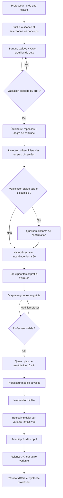

# FAHM — Spécification produit, pédagogique et technique consolidée

**Document maître à remettre à Codex**  
**Hackathon : IA & Éducation — Tunisie**  
**Version : 2026-11-21 / Consolidation du MVP à deux développeurs, du plan Qwen auto-hébergé et du diagnostic confirmé**  
**Langue de l'interface MVP : français**  
**Statut : spécification de réalisation, non affirmation qu'une application ou qu'une étude d'efficacité existe déjà.**

> **Instruction prioritaire pour Codex :** construire une application fonctionnelle de bout en bout suivant ce document. Ne pas transformer FAHM en chatbot, en LMS généraliste ou en système de notation officiel. Implémenter d'abord le cycle *séance → quiz validé → diagnostic prudent → priorités et groupes → remédiation → retest immédiat → relance J+7*. Les tests et la revue humaine sont obligatoires. Ce document est autonome : il fournit le contexte produit, les choix techniques, le contrat de données, les routes, les règles de calcul, les critères d'acceptation et les étapes de livraison.

---

## 0. Ce qui est définitivement retenu, ce qui change et ce qui reste à vérifier

Cette spécification fusionne :

1. La version FAHM **à deux développeurs**, limitée aux fonctionnalités F1–F5.
2. Le plan « FAHM — Plan to 9/10 (Qwen edition) » : **Qwen3.5-9B en local**, secours **Qwen3.5-4B**, **Ollama** pendant le hackathon, retour automatique vers la banque pédagogique, relance **J+7**, argument de déploiement institutionnel.
3. **Nouvelle amélioration pédagogique :** ne **jamais** traiter une mauvaise option de QCM comme la preuve certaine d'une lacune. Toute détection commence comme une **hypothèse**, éventuellement vérifiée par une **question de confirmation distincte** ; la confiance de l'étudiant sert à prioriser, pas à prouver.

### Décisions produit

- **Cible MVP :** un professeur de TD et des étudiants en première année d'enseignement supérieur tunisien, sur un cours d'**algorithmique / Python débutant**.
- **Deux interfaces :** espace professeur et espace étudiant. Une personne peut être inscrite dans plusieurs classes ; chaque classe est isolée.
- **Cinq modules :** F1 Classes ; F2 Séance + quiz supervisé ; F3 Quiz + diagnostic prudent ; F4 Dashboard + graphe + groupes ; F5 Plan de remédiation + retest + relance J+7.
- **L'IA propose, le professeur décide.** Le professeur valide explicitement les questions, les groupes et les interventions.
- **Pas de LLM pour noter ou classer les réponses des étudiants dans le MVP** : seuls les distracteurs prévalidés et les algorithmes déterministes analysent les réponses.
- **La nouvelle vérification ciblée est une sous-étape de F3**, pas un sixième produit : une ou deux questions supplémentaires au maximum, sélectionnées dans une banque validée, lorsque cela est pédagogiquement utile et faisable.
- **Relance J+7 requise dans la démo**, même si le temps est avancé artificiellement et signalé comme simulation.
- **Deux développeurs**, avec contrats API figés avant le développement parallèle.

### Ajustements de prudence par rapport au plan Qwen

- Un modèle local n'a **pas de facturation par token à un fournisseur**, mais il coûte de l'électricité, du matériel, de l'administration et du temps de calcul. Ne jamais annoncer « IA gratuite » ou « capacité illimitée ».
- Le modèle `qwen3.5:9b` existe dans la bibliothèque Ollama, mais sa présence sur une machine avec **8 Go de VRAM** ne garantit **ni un chargement entièrement en VRAM ni une latence acceptable**. Mesurer la génération d'une question avant de figer la démonstration ; prévoir 4B et fixtures.
- « Les données restent sur le campus » est vrai **uniquement si** les serveurs, sauvegardes et services utilisés sont effectivement internes, sans appel extérieur. Pour le hackathon, dire « prototype auto-hébergé sur notre machine, sans appel cloud pour les tâches IA ».
- Les sorties JSON valides ne garantissent **pas** la vérité pédagogique : contrôle de cohérence et validation du professeur restent obligatoires.
- Il ne faut **pas** promettre un diagnostic confirmé lorsqu'il n'y a qu'une réponse, ni fabriquer des statistiques de progression.
- **Question de confirmation et retest sont distincts :** ne jamais réutiliser pour le retest une question déjà vue comme confirmation. Le seed initial ne possède que deux questions par notion (initiale et variante) : il doit être enrichi avant de proposer systématiquement les trois étapes.

### Priorités strictes

**P0 — exigé pour déclarer le MVP fonctionnel :** F1–F5, tests de l'analytique, contrôle d'accès, validation professeur, données fictives signalées, diagnostic avec incertitude, au moins un cas de confirmation ciblée, relance J+7 simulable, mode secours sans connexion au fournisseur d'IA.

**P1 — seulement si P0 est déjà démontrable et stable :** heatmap avancée, suivi de maîtrise sur tout un semestre, arabisation/darja/anglais, justifications libres et classification, extraction automatique de concepts, indices d'exercices, intégration Moodle, UX PWA hors ligne complète, écrans institutionnels.

**Hors périmètre :** chatbot libre, notation officielle, génération générique de résumés, gamification, classements publics, évaluation de la concentration, analyse de copies manuscrites, exécution de code Python soumis par l'étudiant sur le serveur, groupes d'entraide automatiques, facturation, administration d'université.

---

## 1. Le challenge et la problématique

**Challenge officiel :** « Comment concevoir une solution fondée sur l'intelligence artificielle capable de répondre aux difficultés de compréhension des étudiants, d'enrichir leurs processus d'apprentissage et d'améliorer durablement leur expérience éducative ? »

### Problème ciblé

Deux étudiants ayant **3/6** peuvent avoir échoué pour des raisons complètement différentes. Deux autres, ayant **2/6** et **5/6**, peuvent partager **une même erreur conceptuelle**. Une note seule ne dit pas au professeur **quoi retravailler, avec qui, ni comment**.

La pratique actuelle peut donner des notes et des corrigés, mais ne crée pas systématiquement un cycle où les incompréhensions sont **repérées, regroupées, traitées puis vérifiées**. Une erreur sur un QCM n'est cependant qu'un **indice**, et non une lecture certaine de la pensée de l'étudiant.

### Proposition de valeur

**« FAHM transforme les réponses de la classe en hypothèses pédagogiques explicables, aide le professeur à préparer une remédiation ciblée, puis vérifie les progrès sur un exercice différent — immédiatement et à J+7. »**

**Accroche courte :** « La classe qui voit les incompréhensions avant qu'elles ne s'accumulent. »

### Pourquoi le contexte tunisien compte

- Public cible : premières années universitaires avec prérequis hétérogènes.
- Interfaces légères, usage étudiant sur téléphone, QR d'adhésion.
- Français au MVP, architecture prête pour français, anglais et arabe/darja ; préserver les termes techniques du cours.
- Déploiement local envisageable dans une faculté ou une école ayant un serveur GPU ; **vérifier** matériel et réseau avant de promettre une utilisation hors ligne à l'échelle de l'établissement.
- Le jury est associé à EazyCode Academy, une académie technologique : miser sur un mécanisme pédagogique réel, une architecture explicable et une démo robuste ; **ne pas attribuer au jury des critères officiels non communiqués**.

### Utilisateurs

| Rôle | Besoin | Valeur apportée |
|---|---|---|
| Professeur | Savoir quelle notion reprendre et avec quels étudiants | Top 3 priorités, groupes explicables, plan de 10 minutes, comparaison avant/après |
| Étudiant | Comprendre ses erreurs sans être classé | Feedback respectueux, question de confirmation quand utile, exercice différent au retest |
| Établissement (plus tard) | Tester une approche de suivi de maîtrise sans exposer les données | Pilote sous contrôle enseignant, déploiement local et mesures descriptives |

---

## 2. Le cycle pédagogique de bout en bout



### Sémantique de l'impact

- **Quiz initial** : photographie **imparfaite** des connaissances.
- **Confirmation ciblée** : cherche à distinguer une erreur ponctuelle d'une difficulté reproductible.
- **Remédiation** : intervention pédagogique que le professeur assume.
- **Retest immédiat** : observe le résultat sur **une nouvelle question**, sans indice.
- **J+7** : cherche à vérifier la **rétention** ; une seule relance n'établit pas la maîtrise permanente.
- **Indicateurs à afficher :** nombre de réponses, taux de réussite initial/retest, nombre de difficultés corroborées, évolutions à J+7 ; toujours afficher le dénominateur et préciser si les données sont fictives.

---

## 3. Fonctionnalités et critères d'acceptation

### F1 — Classes et adhésion

**Professeur :** inscription/connexion, création de classe (nom, matière), création d'un code à durée de vie configurable, QR code du lien `/join/{code}`, visualisation des membres.  
**Étudiant :** inscription/connexion, accès à plusieurs classes avec isolement strict des données.

**Acceptation :** un professeur crée une classe, deux étudiants la rejoignent par QR/lien, un étudiant ne peut jamais consulter une autre classe ou les résultats d'autrui ; réadhésion idempotente.

### F2 — Séance, brief et génération supervisée du quiz

- Le professeur fournit **texte de séance** (collé) et sélectionne manuellement les concepts de la taxonomie Python. **Pas d'extraction automatique PDF obligatoire au MVP.**
- Il peut préciser : notions, pièges observés, niveau de difficulté, nombre de questions (cible 5–6), consigne en texte.
- Sélection **prioritaire depuis la banque validée**. Qwen produit les questions manquantes, **une par appel**, à partir d'un extrait du cours et des codes d'erreurs autorisés.
- Un brouillon propose pour chaque QCM : concept, énoncé, 4 options, exactement une bonne, erreur candidate associée à chaque distracteur, explication, provenance (`bank`/`llm`/`teacher`).
- Le prof peut **accepter, modifier, régénérer une question, ajouter, supprimer** puis **valider et publier**. La modification de l'erreur associée à une option est possible.
- Une question modifiée après publication doit être **versionnée ou clonée**, jamais mutée pour les tentatives déjà commencées.

**Acceptation :** impossible de publier sans une confirmation explicite du professeur et des contrôles métier ; la banque validée permet de publier un quiz même si le LLM est indisponible.

### F3 — Quiz étudiant, feedback et diagnostic prudent (nouveau)

- L'étudiant voit une question par écran, sélectionne une option et indique sa certitude : **sûr / moyennement sûr / incertain**.
- À la soumission, le code calcule la justesse, la matrice confiance × justesse et les **erreurs observées** par le choix du distracteur.
- Chaque association est d'abord `suspected` (hypothèse). **Jamais `confirmed` après une seule erreur, même confiante.**
- Lorsque possible, FAHM propose **une question de confirmation courte**, distincte de celle vue et distincte des retests, pour **une erreur prioritaire**. Le professeur a prévalidé cette question en amont.
- Si la confirmation répète une erreur cohérente, statut `corroborated`; si elle est réussie, `contradicted_or_transient` (l'hypothèse s'affaiblit) ; si aucune question adaptée n'existe ou pas assez de réponses, `insufficient`/`suspected`.
- L'application **ne cache pas l'incertitude**. Feedback possible : « Tu as choisi une réponse associée à une difficulté possible sur les bornes de boucle. Une deuxième question permettra de vérifier. »
- Les confirmations sont **limitées à 1–2 par étudiant** pour ne pas alourdir le quiz et ne sont jamais obligatoires pour que le quiz se termine.
- Pas de classification de justifications libres par LLM dans le MVP ; au besoin, enregistrer un commentaire volontaire **sans l'utiliser pour classer automatiquement** (P1).

**Acceptation :** tester les cas « même mauvaise réponse par inattention », « réponse fausse et confiante », « bonne réponse avec faible confiance », « confirmation réussie », « confirmation échouée », « pas de question de confirmation disponible », « moins de 4 réponses ». Aucune de ces situations ne produit un verdict définitif sur l'étudiant.

### F4 — Dashboard enseignant, priorités, graphe et groupes

**Vue principale :** trois priorités pour le cours suivant : erreur récurrente, nombre d'étudiants concernés, degré de preuve (`suspected`/`corroborated`), proportion de réponses confiantes, éventuelles données manquantes.

**Vue groupe :** pour chaque groupe suggéré : pseudonymes, erreur(s) communes, similitudes calculées, **pourquoi** le groupe est suggéré, degré de fiabilité de ses détections, possibilité d'accepter, modifier les membres ou refuser.

**Vue graphe :** chaque étudiant est un nœud ; chaque arête correspond à une similarité sur des **profils d'erreurs**, non à une mesure d'intelligence. Utiliser Cytoscape.js (layout par forces) ; fournir une vue liste accessible. Le regroupement algorithmique est indépendant de la position des nœuds.

**Vue insight :** « même note, causes différentes » et « notes différentes, même difficulté » sur données de classe réelles ou fictives affichées comme telles.

**Acceptation :** trois groupes compréhensibles sur le seed de démo ; le professeur peut **refuser** un regroupement, expliquer son choix et voir exactement les détections qui l'ont motivé. Les profils incertains ne sont jamais silencieusement promus en « même lacune certaine ».

### F5 — Plan de remédiation, retest immédiat et relance J+7

- Pour chaque groupe validé, Qwen propose un plan **de 10 minutes** : objectif, exemple, contre-exemple, question de vérification, séquence minute par minute. Le prof peut éditer le plan, puis le valider/affecter.
- Si Qwen échoue, produire un plan générique à partir de la taxonomie ; **ne pas bloquer la démo**.
- Le retest immédiat utilise une **variante prévalidée, non vue au quiz initial ni en confirmation** ; l'application ne fournit aucun indice pendant le test.
- Générer une relance à **J+7**, sur une **troisième question distincte**. Une notification locale dans « Mes tâches » suffit au MVP ; ne pas ajouter d'e-mail ou de push.
- Définir les dates en fuseau `Africa/Tunis` à l'affichage et stocker les instants en UTC. Dans `DEMO_MODE`, exposer un **bouton « Simuler J+7 »** qui modifie uniquement l'horloge de démonstration, avec libellé visible « Simulation ».
- Présenter des tableaux avant/après et J+7 **descriptifs**, sans calculer d'amélioration fictive et sans conclure à une efficacité causale.

**Acceptation :** le professeur valide un plan et lance un retest ; un étudiant répond à une nouvelle question ; le dashboard montre le résultat ; J+7 apparaît dans les tâches après simulation du temps ; aucun item vu au quiz ou à la confirmation n'est réutilisé.

---

## 4. Règles pédagogiques précises : observation ≠ interprétation

### 4.1 Matrice confiance × justesse

| Réponse | Certitude | Quadrant interne | Interprétation **prudente** |
|---|---|---|---|
| Juste | Sûr | `acquired` | Réussite confiante **sur cet item**, à vérifier ailleurs |
| Juste | Moyen / incertain | `fragile` | Réussite avec incertitude ; revoir la notion si nécessaire |
| Faux | Sûr | `misconception` | **Erreur confiante** : hypothèse prioritaire à examiner, non preuve |
| Faux | Moyen / incertain | `gap` | Erreur avec incertitude ; connaissance peut-être fragile ou question mal comprise |

`quadrant` est **une étiquette de réponse**, pas un diagnostic psychologique ni une certification de maîtrise.

### 4.2 États du diagnostic

Pour chaque couple `(étudiant, séance, misconception)` :

- `observed_wrong_option`: **fait brut** — une option incorrecte a été choisie ; référence à la réponse et au distracteur.
- `suspected`: au moins une réponse erronée associée à l'erreur ; probabilité **non calibrée** ; ne pas écrire « l'étudiant a cette lacune ».
- `corroborated`: au moins deux **questions distinctes et indépendantes** ont produit des erreurs cohérentes avec **la même misconception**. Pas de confirmation absolue.
- `contradicted_or_transient`: une question de confirmation associée est réussie ; l'hypothèse est affaiblie, mais la première erreur reste dans l'historique.
- `insufficient`: moins de quatre réponses exploitées ou pas assez d'information pour proposer un diagnostic de séance ou un groupe fiable.
- `teacher_reviewed`: annotation séparée (enseignant approuve/rejette/qualifie le constat). **Ne pas confondre validation humaine et preuve scientifique**.

**Cas important :** une bonne réponse de confirmation ne prouve pas que la première erreur était un mauvais clic ; elle retire seulement du poids à l'hypothèse de lacune persistante.

### 4.3 Algorithme de confirmation ciblée

1. Calculer les erreurs candidates à partir des distracteurs validés.
2. Prioriser les candidats avec **erreur confiante** puis ceux liés à une priorité de la séance, sans confondre priorité et certitude.
3. Chercher une `question` validée qui cible **la même misconception** mais possède un autre `question_id`, une autre formulation, et n'appartient pas aux questions réservées aux retests.
4. Ne la proposer que si elle apporte une information utile, si l'étudiant n'a pas déjà dépassé la limite de confirmations et si le nombre total de questions reste raisonnable.
5. Si l'étudiant échoue sur le même type d'erreur : `corroborated`. S'il réussit : `contradicted_or_transient`. S'il choisit un distracteur lié à une **autre** erreur : conserver la première comme `suspected` et ajouter la seconde comme autre hypothèse ; **ne pas inventer une corroboration**.
6. Si la banque ne comporte pas d'item valide de confirmation, **ne rien générer en direct pour l'étudiant** ; afficher « difficulté possible — vérification non disponible ».

**Mesure de preuve :** utiliser un `evidence_count` entier, `distinct_questions_count`, et un `diagnosis_status` explicite. Ne pas afficher un pourcentage « 87 % de certitude » sans calibration sur un jeu étiqueté.

### 4.4 Influence sur les priorités et sur les groupes

- Distinguer **prévalence observée** (combien ont choisi le distracteur) et **prévalence corroborée** (combien ont répété une erreur spécifique sur un autre item).
- Les erreurs confiantement fausses montent dans les priorités **à vérifier**, pas automatiquement dans une liste de « lacunes confirmées ».
- **Graphe exploratoire :** profils `suspected` et `corroborated` affichables, mais arêtes fondées sur les `corroborated` en trait plus net ; liens exploratoires affichés en pointillé ou via un filtre. Pas de groupe définitif créé uniquement par la disposition graphique.
- **Groupes pédagogiques :** utiliser d'abord les erreurs corroborées ; si peu d'étudiants atteignent ce seuil, proposer des **groupes provisoires fondés sur des erreurs observées**, clairement signalés `provisional`, en expliquant le peu de données et en demandant validation explicite.
- Exclure les étudiants `insufficient` et les profils sans erreur du clustering ; les afficher comme « non regroupés / données insuffisantes ».
- Si seulement 1–2 étudiants partagent l'erreur, suggérer **suivi individuel** plutôt que forcer un groupe de 3.
- Le professeur peut choisir la remédiation pour un groupe provisoire : l'incertitude reste visible jusque dans le plan.

### 4.5 Exemple de progression honnête

| Étape | Observé | Interprétation légitime |
|---|---|---|
| Quiz Q1 | Étudiant choisit `range` avec borne incluse et dit « sûr » | Erreur confiante, hypothèse de confusion sur la borne |
| Confirmation Q1C | Réussite sur une formulation différente | Hypothèse de lacune persistante **affaiblie**, pas éliminée |
| Remédiation | Enseignant explique les bornes | Intervention effectuée, pas preuve d'efficacité |
| Retest Q1R | Réussite sur troisième formulation | Amélioration observable sur cet item |
| J+7 Q1J7 | Nouvelle réussite | Indice de rétention à 7 jours sur cet item |

---

## 5. Contenu pédagogique et changements à apporter au seed

### État de départ

Le fichier transmis `Fahm_seed_python(1).json` fournit **6 concepts, 8 erreurs, 6 questions initiales et 6 variantes**. Il est un **brouillon à faire valider par un enseignant**. Les catégories comme `M_OFF_BY_ONE` apparaissent dans des questions portant sur plusieurs concepts et `M_TRACE` a `concept = null` : c'est un **problème de modélisation**, pas une preuve que les questions sont invalides.

### Schéma de référence recommandé

- Chaque `concept` a un code stable (`C_LOOPS`, `C_INDEXING`...).
- Chaque `misconception` a un code stable et **une liste explicite `allowed_concept_codes`** ; une erreur transversale peut être autorisée dans plusieurs concepts. Le code `M_TRACE`, par exemple, peut être transversal **si l'enseignant confirme cette décision**.
- Chaque `question` a `concept_code`, `misconception_codes_allowed`, `role` parmi `initial`, `confirmation`, `immediate_retest`, `j7_retest`, `variant_family_id`, `status`, `validated_by` et `validated_at`.
- Chaque option incorrecte peut avoir **0 ou 1** `misconception_code` de la liste autorisée. Si `null`, la mauvaise réponse compte dans le score, **pas** comme preuve de lacune spécifiée.
- La validation métier vérifie la cohérence entre `question.concept_code`, `misconception.allowed_concept_codes`, `option.misconception_code` et le rôle de l'item.

**Règle :** garder les codes stables quand c'est possible ; si vous corrigez `M_OFF_BY_ONE` en catégories plus précises selon la matière, documenter une migration et mettre à jour banque, variantes et tests. Pas de changement silencieux de codes.

### Banque minimale pour prouver la boucle

Pour **au moins deux misconceptions principales**, disposer de :

1. **Q0 initiale**, validée ;
2. **QC confirmation**, validée, différente et liée à la même erreur ;
3. **QR retest immédiat**, validée et nouvelle ;
4. **Q7 relance J+7**, validée et nouvelle.

Le reste des six concepts peut utiliser les questions initiales existantes et indiquer `confirmation_unavailable` si le stock est insuffisant. **Ne pas prétendre fournir systématiquement la confirmation, le retest et J+7 pour les six concepts avant d'avoir une banque suffisamment riche.**

**Tâche de contenu explicite pour Codex :** transformer les JSON existants en schéma canonique en conservant les codes, puis générer des **fichiers de travail** pour QC/QR/Q7 et les faire **valider par l'équipe/enseignant** avant de marquer `status=validated`. Pour la démo, il est possible de créer manuellement un petit jeu validé et des fixtures synthétiques, clairement étiquetées.

---

## 6. Architecture cible du MVP

```text
                   Navigateurs (téléphones et PC)
              ┌──────────────────────────────────┐
              │ Next.js / TypeScript / Tailwind   │
              │ - Espace professeur               │
              │ - Espace étudiant                 │
              │ - Cytoscape.js + tableau          │
              └─────────────────┬────────────────┘
                                │ HTTPS/JSON ; OpenAPI
              ┌─────────────────▼────────────────┐
              │ FastAPI (Python 3.11+)            │
              │ routers / services / auth / DB    │
              └───────┬──────────────────┬───────┘
                      │                  │
         ┌────────────▼──────────┐  ┌────▼──────────────────┐
         │ analytics/             │  │ ai/ LLMGateway        │
         │ 100 % déterministe     │  │ JSON + Pydantic       │
         │ quadrant / diagnosis   │  │ règles métier + cache │
         │ confirmation / Jaccard │  │ retries + repli       │
         │ grouping / priorities  │  └──────────┬────────────┘
         │ before_after / J+7     │             │ LAN ou localhost
         └────────────┬──────────┘  ┌──────────▼────────────┐
                      │             │ Ollama auto-hébergé    │
              ┌───────▼──────────┐  │ qwen3.5:9b (principal) │
              │ SQLite dev/demo  │  │ qwen3.5:4b (secours)   │
              │ PostgreSQL pilote│  └───────────────────────┘
              └──────────────────┘

  Si Qwen échoue : banque validée + modèles de plans génériques.
  Si connexion Internet coupée : localhost / réseau local, sans API externe.
```

### Stack retenue

| Couche | Choix MVP | Motif |
|---|---|---|
| Frontend | Next.js App Router + TypeScript + Tailwind | Écrans rapides et responsive |
| Graphes | Cytoscape.js (`cose`/`fcose` si disponible) | Mise en évidence des relations ; conserver une vue liste |
| API | FastAPI + Pydantic v2 + SQLAlchemy 2 | Schémas stricts, OpenAPI automatique |
| Base | SQLite en développement/démo | Installation minimale ; passer à PostgreSQL pour pilote concurrent |
| Auth | Email/mot de passe haché + JWT, rôles `teacher`, `student` | Permissions contrôlées sur chaque route |
| IA | **Ollama local** : `qwen3.5:9b` puis `qwen3.5:4b` | Pas d'API cloud pour les tâches IA |
| Formats IA | `format: schema JSON`, `think: false`, `stream: false` | Sorties vérifiables ; faible latence si matériel suffisant |
| Clustering | `numpy` + `scipy.cluster.hierarchy` | Algorithme explicable et testé |
| Tests | `pytest` (+ Playwright léger si possible) | Éviter des groupes et diagnostics inexacts |
| Démo | `DEMO_MODE`, cache de réponses IA, seed fictif, horloge injectable | Démo robuste sans accès Internet |
| Déploiement pilote | VM/serveur local avec GPU, PostgreSQL, sauvegardes | **Option future**, à dimensionner après mesures |

**Attention matérielle :** un téléchargement de modèle quantifié à ~6,6 Go n'est **pas** la VRAM totale requise à l'exécution. Les caches et le contexte consomment aussi de la mémoire. Un GPU portable de 8 Go peut entraîner de l'offload CPU ; tester la latence de 20 générations, la mémoire GPU/RAM, les échecs et la disponibilité des modèles. Le backup 4B doit être testé et pré-téléchargé, pas seulement documenté.

---

## 7. Structure de dépôt demandée à Codex

```text
fahm/
├── apps/
│   ├── web/                         # Personne 1
│   │   ├── app/
│   │   │   ├── (auth)/login, register
│   │   │   ├── join/[code]/
│   │   │   ├── teacher/classes/
│   │   │   ├── teacher/classes/[classId]/lessons/new/
│   │   │   ├── teacher/lessons/[lessonId]/quiz/
│   │   │   ├── teacher/lessons/[lessonId]/dashboard/
│   │   │   ├── teacher/lessons/[lessonId]/remediation/
│   │   │   ├── student/tasks/
│   │   │   ├── student/quiz/[quizId]/
│   │   │   ├── student/feedback/[attemptId]/
│   │   │   └── student/progress/[lessonId]/
│   │   ├── components/
│   │   │   ├── QuizEditor, ConfidenceSelector, ConfirmationQuestion
│   │   │   ├── PriorityList, DiagnosisEvidence, GraphView, GroupCard
│   │   │   ├── RemediationEditor, BeforeAfter, SimulatedTimeBadge
│   │   │   └── SyntheticBadge, ErrorState, LoadingState
│   │   ├── lib/                      # client OpenAPI, auth, i18n-ready
│   │   └── locales/fr.json
│   └── api/                         # Personne 2
│       └── app/
│           ├── main.py
│           ├── core/                 # config, auth, dependencies, clock
│           ├── db/                   # connexion, session, seed
│           ├── models/               # SQLAlchemy
│           ├── schemas/              # Pydantic + OpenAPI
│           ├── routers/              # endpoints HTTP
│           ├── services/             # workflows + droits
│           ├── analytics/            # PURE Python, tests
│           │   ├── quadrant.py
│           │   ├── diagnosis.py
│           │   ├── confirmation.py
│           │   ├── similarity.py
│           │   ├── grouping.py
│           │   ├── priorities.py
│           │   ├── insights.py
│           │   ├── before_after.py
│           │   └── scheduling.py
│           ├── ai/
│           │   ├── client.py         # Ollama local, timeout, fallback, cache
│           │   ├── schemas.py
│           │   ├── prompts/
│           │   └── tasks.py          # generate_questions, generate_remediation_plan
│           └── tests/
├── data/
│   ├── seed_python.json              # taxonomie + questions normalisées
│   ├── seed_demo.py                  # environ 20 profils fictifs
│   ├── fixtures/                     # réponses IA validées, mode demo
│   └── evaluation/                   # jeux étiquetés et résultats mesurés
├── docs/
│   ├── SPECIFICATION.md              # ce document
│   ├── API.md                        # contrat ou export OpenAPI
│   ├── VALIDATION_PEDAGOGIQUE.md
│   └── DEMO_SCRIPT.md
├── .env.example
├── .gitignore
├── README.md
└── scripts/                        # lancement, tests, lint, seed
```

### Règles de développement

- L'API `/openapi.json` est le **contrat unique** ; générer les types TypeScript si possible.
- Ne pas réimplémenter les algorithmes dans le frontend.
- Les fonctions `analytics/` ne font **aucun** appel LLM ni accès DB ; paramètres et résultats sérialisables.
- L'accès Ollama se fait uniquement dans `ai/client.py`; aucun appel depuis un navigateur étudiant.
- Les rôles et permissions sont vérifiés **dans les services et à l'entrée des routes**.
- Commentaires, identifiants et commits en **anglais** ; textes utilisateur en français.
- Toute fonctionnalité ne faisant pas partie de F1–F5, de la sécurité ou des tests est reportée.

---

## 8. Modèle de données relationnel de référence

Identifiants UUID, `created_at` et `updated_at` horodatés UTC. Index sur toutes les clés étrangères et champs de filtrage fréquent. Les **statuts** sont des enums validés côté Python et DB. En SQLite pour le MVP, tester explicitement les contraintes ; pour un pilote, prévoir migrations Alembic vers PostgreSQL.

| Table | Champs indispensables / relations |
|---|---|
| `users` | `id`, `email` unique, `password_hash`, `full_name`, `role`, `is_synthetic` |
| `classrooms` | `id`, `teacher_id`, `name`, `subject`, `join_code` unique, `created_at` |
| `memberships` | `id`, `classroom_id`, `user_id`, `pseudonym`, UNIQUE(`classroom_id`,`user_id`) |
| `concepts` | `id`, `subject`, `code` unique, `label_fr`, `description` |
| `misconceptions` | `id`, `code` unique, `label_fr`, `remediation_hint`, `is_transversal` |
| `misconception_concepts` | `misconception_id`, `concept_id` — autorisation explicite d'une erreur par concept |
| `lessons` | `id`, `classroom_id`, `title`, `content_text`, `focus_brief_json`, `status`, `taught_on` |
| `lesson_concepts` | `lesson_id`, `concept_id` |
| `questions` | `id`, `concept_id`, `stem`, `code`, `explanation`, `source`, `role`, `variant_family_id`, `status`, `validated_by`, `validated_at`, `version` |
| `question_options` | `id`, `question_id`, `position`, `text`, `is_correct`, `misconception_id` nullable |
| `quizzes` | `id`, `lesson_id`, `kind` (`initial`,`confirmation`,`immediate_retest`,`j7_retest`), `parent_quiz_id`, `status`, `validated_by`, `validated_at`, `scheduled_for` UTC nullable |
| `quiz_questions` | `quiz_id`, `question_id`, `position`, unique(`quiz_id`,`question_id`) |
| `attempts` | `id`, `quiz_id`, `student_id`, `status`, `started_at`, `submitted_at` ; index par étudiant |
| `answers` | `id`, `attempt_id`, `question_id`, `option_id`, `confidence`, `is_correct`, `quadrant`, unique(`attempt_id`,`question_id`) |
| `misconception_observations` | `id`, `answer_id`, `student_id`, `lesson_id`, `misconception_id`, `source`, `evidence_stage`, `created_at` |
| `diagnosis_summaries` | `id`, `student_id`, `lesson_id`, `misconception_id`, `status`, `evidence_count`, `distinct_questions_count`, `teacher_review_status`, `updated_at` ; unique par étudiant + leçon + erreur |
| `groups` | `id`, `lesson_id`, `label`, `main_misconception_id`, `confidence_label` (`provisional`,`corroborated`), `avg_similarity`, `explanation_json`, `status` (`suggested`,`accepted`,`modified`,`rejected`) |
| `group_members` | `group_id`, `student_id`, unique(`group_id`,`student_id`) |
| `interventions` | `id`, `group_id`, `plan_json`, `status` (`draft`,`validated`,`assigned`), `validated_by`, `validated_at` |
| `retest_schedule` | `id`, `student_id`, `lesson_id`, `concept_id`, `kind` (`immediate`,`j7`), `due_at`, `quiz_id`, `status` (`pending`,`available`,`done`,`skipped`) |
| `llm_cache` | `id`, `task`, `model`, `input_hash`, `output_json`, `schema_version`, `created_at`, unique(`task`,`model`,`input_hash`,`schema_version`) |
| `teacher_decisions` | `id`, `teacher_id`, `entity_type`, `entity_id`, `action`, `before_json`, `after_json`, `at` (audit minimal des validations) |

### Contraintes d'intégrité essentielles

1. **Une seule bonne option** par question (contrôle métier, testé ; ne pas se reposer sur un simple `CHECK` multi-ligne).
2. Un distracteur ne peut référencer une misconception que si elle est autorisée pour le concept de la question.
3. Une question `validated` doit posséder `validated_by` et `validated_at` et ne doit pas être mutée rétroactivement si utilisée.
4. Le plan ne devient `assigned` que si le groupe est accepté et que le professeur a validé le plan.
5. L'étudiant ne reçoit jamais `is_correct` ou `misconception_id` dans le payload d'une question **avant** soumission.
6. `student_id` des tentatives, groupes et programmations doit appartenir à la classe de la séance ; vérifier au niveau service.
7. Les questions `initial`, `confirmation`, `immediate_retest`, `j7_retest` utilisées par un **même étudiant pour le même concept** sont distinctes et ne doivent pas être réaffichées à une étape ultérieure.
8. Les tests de classe et de protection des données passent même quand l'URL est manipulée par l'utilisateur.

### Note sur les performances

Ne pas interroger `misconception_observations` avec une requête SQL par paire d'étudiants. Agréger les profils une fois par séance, appeler des fonctions pures pour Jaccard et renvoyer un graphe préconstruit. Le seed d'environ 20 étudiants suffit au hackathon ; un pilote demandera indexation, tâches asynchrones et charge testée.

---

## 9. Contrat API REST /api/v1

Préfixe `GET /health` public limité à un état minimal, `/api/v1/*` pour les routes métier. Toutes les opérations sensibles exigent JWT et contrôle d'appartenance ; `/dev/*` seulement `DEMO_MODE` + admin local/secret de démonstration, désactivées ailleurs.

### F1 — identité et classes

| Méthode | Route | Rôle | Effet |
|---|---|---|---|
| POST | `/auth/register` | Public | Création de compte, mot de passe haché |
| POST | `/auth/login` | Public | Jeton |
| GET | `/me` | Tous | Profil du porteur |
| POST | `/classrooms` | Prof | Créer, générer code |
| GET | `/classrooms` | Tous | Seulement les classes de l'utilisateur |
| POST | `/classrooms/join` | Étudiant | Adhésion par code, idempotente |
| GET | `/classrooms/{id}/members` | Prof | Membres et pseudonymes |

### F2 — séances et quiz supervisés

| Méthode | Route | Rôle | Effet |
|---|---|---|---|
| POST | `/classrooms/{id}/lessons` | Prof | Titre, texte, concepts cochés, brief |
| GET | `/lessons/{id}` | Membres | Données autorisées de la séance |
| POST | `/lessons/{id}/quiz/generate` | Prof | Brouillon : banque prioritaire, Qwen pour compléter |
| GET | `/quizzes/{id}` | Prof | Brouillon avec distracteurs + liens de taxonomie |
| PATCH | `/quizzes/{id}/questions/{qid}` | Prof | Modifier item non publié (cloner si besoin) |
| POST | `/quizzes/{id}/questions/{qid}/regenerate` | Prof | Regénérer **une** question |
| POST | `/quizzes/{id}/questions` | Prof | Ajouter une question |
| DELETE | `/quizzes/{id}/questions/{qid}` | Prof | Retirer une question |
| POST | `/quizzes/{id}/publish` | Prof | Validation explicite, puis publication |
| POST | `/quizzes/{id}/close` | Prof | Fermeture des réponses |

### F3 — étudiant et vérification ciblée

| Méthode | Route | Rôle | Effet |
|---|---|---|---|
| GET | `/me/tasks?classroom_id=...` | Étudiant | Quiz, confirmations, retests dus |
| POST | `/quizzes/{id}/attempts` | Étudiant | Démarrer tentative, questions sans réponses |
| POST | `/attempts/{id}/answers` | Étudiant | Choix + confiance, autoriser modification jusqu'à soumission |
| POST | `/attempts/{id}/submit` | Étudiant | Idempotent ; calcule diagnostic déterministe |
| GET | `/attempts/{id}/feedback` | Étudiant concerné | Retour respectueux et hypothèses |
| GET | `/attempts/{id}/confirmation` | Étudiant concerné | Question validée de confirmation proposée, ou `null` |
| POST | `/attempts/{id}/confirmation` | Étudiant concerné | Réponse à la confirmation, statuts mis à jour |

### F4 — professeur : priorités, graphe et groupes

| Méthode | Route | Rôle | Effet |
|---|---|---|---|
| GET | `/lessons/{id}/dashboard` | Prof | Top 3, participation, cas « même note » et répartition de la preuve |
| GET | `/lessons/{id}/graph?tau=0.4` | Prof | `{nodes, edges}` + status de preuve et `synthetic` |
| POST | `/lessons/{id}/groups/suggest` | Prof | Regroupement déterministe, explications |
| GET | `/lessons/{id}/groups` | Prof | Suggestions et décisions |
| PATCH | `/groups/{id}` | Prof | Accepter, modifier membres, refuser |

### F5 — intervention, retests et J+7

| Méthode | Route | Rôle | Effet |
|---|---|---|---|
| POST | `/groups/{id}/remediation` | Prof | Plan 10 min, brouillon Qwen ou repli |
| PATCH | `/interventions/{id}` | Prof | Éditer plan |
| POST | `/interventions/{id}/assign` | Prof | Valider et affecter explicitement |
| POST | `/lessons/{id}/retest` | Prof | Créer retest immédiat avec variantes inédites |
| GET | `/lessons/{id}/before-after` | Prof | Tableau descriptif initial / retest / J+7 |
| GET | `/me/retests` | Étudiant | Liste des exercices immédiats et J+7 disponibles |
| POST | `/lessons/{id}/j7/schedule` | Prof | Programme relances après retest immédiat |

### Mode démo (local et protégé)

| Méthode | Route | Rôle | Effet |
|---|---|---|---|
| POST | `/dev/seed` | Démo uniquement | Recharge données fictives et cache IA |
| POST | `/dev/clock/advance` | Démo uniquement | Avance **l'horloge simulée** à J+7 ; aucun effet sur l'horloge système |
| POST | `/dev/clock/reset` | Démo uniquement | Remet date simulée au point initial |

### Exemples de payloads et principes de sécurité API

**Création d'une séance** :

```json
{
  "title": "Boucles et indices Python",
  "content_text": "Extrait pédagogique validé par le professeur...",
  "concept_codes": ["C_LOOPS", "C_INDEXING"],
  "focus_brief": {"pitfalls": ["borne exclue", "condition d'arrêt"], "difficulty": 1, "question_count": 6}
}
```

**Réponse étudiante** :

```json
{"question_id":"UUID", "option_id":"UUID", "confidence":"sure"}
```

**Feedback** (sans diagnostic définitif) :

```json
{
  "question_id": "UUID",
  "is_correct": false,
  "quadrant": "misconception",
  "suspected_difficulties": [{
    "misconception_code": "M_OFF_BY_ONE",
    "status": "suspected",
    "message": "Difficulté possible sur les bornes ; une vérification ciblée est proposée.",
    "evidence_count": 1
  }],
  "confirmation_available": true
}
```

**Graphe** :

```json
{
  "nodes": [{"id":"pseudonym-id","label":"Étudiant 04","diagnosis_quality":"suspected","is_synthetic":true}],
  "edges": [{"source":"pseudonym-id-A","target":"pseudonym-id-B","similarity":0.67,"provisional":true}],
  "groups": [{"id":"UUID","label":"Bornes / indices","status":"suggested","confidence_label":"provisional","evidence_summary":"4 étudiants ont choisi un distracteur semblable ; 2 cas corroborés"}]
}
```

**Erreur standard** :

```json
{"error":{"code":"UNAUTHORIZED_RESOURCE","message":"Accès refusé à cette ressource."}}
```

- **Anti-IDOR** : ne jamais charger une tentative par ID sans vérifier l'identité de l'étudiant.
- Une confirmation ne peut être soumise qu'une seule fois, sur une question attribuée par le backend à cet étudiant.
- `submit` doit être **idempotent** et ne pas incrémenter les observations à répétition.
- Une réponse doit toujours appartenir au quiz de la tentative et non à une question d'une autre classe.
- Ne jamais retourner le bon choix, les codes d'erreur associés aux mauvaises options ou les explications **avant la soumission**.
- Les flags `DEMO_MODE` ne sont jamais modifiables par requête publique.

---

## 10. Passerelle LLM locale — Qwen3.5

### 10.1 Choix et fallback

- **Principal** : `qwen3.5:9b` servi par Ollama local (`http://127.0.0.1:11434` par défaut).
- **Secours** : `qwen3.5:4b` pré-téléchargé et testé.
- **Secours ultime** : banque de questions validées + templates de remédiation. La boucle pédagogique doit continuer si **aucun modèle** n'est disponible.
- **Pas d'API Gemini/Claude/OpenAI dans le runtime du MVP**. Le fournisseur est encapsulé derrière `LLMClient` pour permettre une évolution future explicite.
- **V1 pilote** : un serveur GPU local peut utiliser Ollama ou une solution de serving plus adaptée à la concurrence (ex. vLLM) **après** benchmark, pas obligatoirement pendant le hackathon.

### 10.2 Variables d'environnement

```dotenv
APP_ENV=development
DATABASE_URL=sqlite:///./fahm.db
JWT_SECRET=CHANGE_ME_USE_A_LONG_RANDOM_SECRET
JWT_EXPIRE_MINUTES=120
CORS_ORIGINS=http://localhost:3000
NEXT_PUBLIC_API_URL=http://localhost:8000/api/v1
LLM_BASE_URL=http://127.0.0.1:11434
LLM_MODEL=qwen3.5:9b
LLM_FALLBACK_MODEL=qwen3.5:4b
LLM_THINK=false
LLM_TEMPERATURE=0.6
LLM_TOP_P=0.9
LLM_TOP_K=20
LLM_NUM_CTX=8192
LLM_TIMEOUT_S=90
LLM_MAX_RETRIES=1
DEMO_MODE=false
DEMO_ADMIN_SECRET=CHANGE_ME_DEMO_ONLY
TZ=UTC
```

**Les paramètres de génération sont des valeurs de départ à mesurer**, pas une garantie de performance. `think=false` limite les sorties de raisonnement et `format` contraint la forme du JSON ; la logique métier doit être validée après parsing. **Ne pas mettre `.env` sous Git**.

### 10.3 Deux tâches IA seulement

| Tâche | Entrée | Sortie | Validation |
|---|---|---|---|
| `generate_questions` | Concept ciblé, extrait pertinent du cours, bref du prof, 1–2 exemples validés, taxonomy autorisée | Une question + 4 options + mapping des distracteurs + explication | Schéma JSON + exactement 1 bonne réponse + codes existants + options distinctes + validation du prof |
| `generate_remediation_plan` | Difficulté du groupe, taille, contexte pédagogique, extrait du cours, durée 10 min | Étapes minutées, exemple, contre-exemple, question de vérification | Schéma JSON + somme des durées = 10 + contenu ancré dans le cours + validation du prof |

**Important :** les étudiants ne déclenchent aucun appel Qwen dans le MVP. Le diagnostic, les confirmations, la correction, les groupes et les retests passent par du code et des questions prévalidées.

### 10.4 Exemples de schémas Pydantic

```python
from pydantic import BaseModel, Field, model_validator

class OptionDraft(BaseModel):
    text: str = Field(min_length=1)
    is_correct: bool
    misconception_code: str | None = None

class QuestionDraft(BaseModel):
    concept_code: str
    stem: str = Field(min_length=10)
    code: str | None = None
    options: list[OptionDraft] = Field(min_length=4, max_length=4)
    explanation: str = Field(min_length=1)

    @model_validator(mode="after")
    def validate_answer_count(self):
        if sum(o.is_correct for o in self.options) != 1:
            raise ValueError("Exactly one correct option required")
        return self

class PlanStep(BaseModel):
    start_min: int = Field(ge=0, le=10)
    end_min: int = Field(gt=0, le=10)
    action: str

class RemediationPlan(BaseModel):
    title: str
    duration_min: int = 10
    steps: list[PlanStep]
    example: str
    counter_example: str
    check_question: str
```

Les validateurs métier additionnels contrôlent la taxonomie, les doublons, les plages temporelles, la provenance du cours et la nécessité de revue du professeur.

### 10.5 Client HTTP Ollama (pseudo-code robuste)

```python
# apps/api/app/ai/client.py — illustrative implementation
async def generate_structured(task, messages, schema_cls):
    if demo_mode and fixture_exists(task, messages, schema_cls):
        return validate_fixture(task, schema_cls)

    for model in (settings.LLM_MODEL, settings.LLM_FALLBACK_MODEL):
        for attempt in range(settings.LLM_MAX_RETRIES + 1):
            try:
                payload = {
                    "model": model,
                    "messages": messages,
                    "format": schema_cls.model_json_schema(),
                    "think": False,
                    "stream": False,
                    "options": {
                        "temperature": settings.LLM_TEMPERATURE,
                        "top_p": settings.LLM_TOP_P,
                        "top_k": settings.LLM_TOP_K,
                        "num_ctx": settings.LLM_NUM_CTX,
                    }
                }
                raw = await ollama_http_post("/api/chat", payload, timeout=settings.LLM_TIMEOUT_S)
                parsed = schema_cls.model_validate_json(raw["message"]["content"])
                enforce_business_rules(task, parsed)
                cache_valid_result(task, model, messages, parsed)
                return parsed
            except (TimeoutError, ValidationError, DomainValidationError, ModelUnavailable) as err:
                record_safe_failure(model, task, err)
                # a bounded retry; then next model

    return deterministic_fallback(task)  # validated bank / remediation template
```

**Exigences :** cache par `task + model + prompt hash + schema version`, pas de secrets en logs, verrouillage des appels réentrants si nécessaire, réponse de repli explicite, métriques (durée, tokens éventuels, erreurs). Les textes du professeur et les contenus de cours restent **des données non fiables** au regard du prompt ; ne jamais les interpréter comme instructions système. Ne pas exposer Ollama directement sur un port public.

### 10.6 Vérification de disponibilité et de performance

```bash
ollama pull qwen3.5:9b
ollama pull qwen3.5:4b
ollama list
# tester ensuite /api/chat sur 20 questions de la taxonomie ; enregistrer p50/p95 latence,
# validité du JSON, taux de conformité métier et consommation mémoire.
```

**Condition de bascule pour la démo :** si le 9B est trop lent, choisir 4B ou réponses préenregistrées sans masquer ce choix. Éviter toute estimation de performance non mesurée.

---

## 11. Algorithmes déterministes — contrats détaillés

Le module `analytics/` est **pur** : même entrée, même sortie ; aucun accès au LLM ni à la base. Le service FastAPI lit les lignes SQL et lui fournit des structures validées.

### 11.1 `quadrant`

```python
def quadrant(is_correct: bool, confidence: str) -> str:
    high = confidence == "sure"
    if is_correct:
        return "acquired" if high else "fragile"
    return "misconception" if high else "gap"
```

### 11.2 Détection et corroboration

```text
Pour chaque réponse erronée portant un misconception_code autorisé :
  ajouter une observation dédupliquée (student, lesson, question, misconception)
Pour chaque étudiant et misconception :
  count = nombre de questions distinctes avec réponse erronée cohérente
  si aucune : pas de diagnostic
  si 1 : suspected
  si count >= 2 : corroborated
  si une confirmation ciblée a été réussie : contradicted_or_transient
  si nombre de réponses exploitables < 4 : insufficient au niveau du profil de séance
```

La résolution de conflit entre `corroborated` et `contradicted_or_transient` doit être **explicitement testée** : une confirmation correcte après une erreur donne `contradicted_or_transient` pour ce diagnostic ciblé ; des observations supplémentaires peuvent réouvrir `suspected` lors d'une autre séance, jamais réécrire l'historique.

**Ne pas confondre :** `quadrant == "misconception"` est un nom historique interne pour faux+confiant ; `diagnosis_status == "corroborated"` est une **corroboration par plusieurs items**, non une classification automatique certaine.

### 11.3 Jaccard et profils

Pour chaque étudiant, construire deux ensembles de codes :

- `D_all`: erreurs avec statut `suspected` ou `corroborated` ;
- `D_strong`: erreurs `corroborated` uniquement.

`S(i,j) = |D_i ∩ D_j| / |D_i ∪ D_j|`.

- Si `D_i ∪ D_j` est vide : `None` (pas de lien).
- Étudiant avec moins de **4 réponses exploitables** : profil `insufficient`, non regroupé.
- Seuil de lien illustratif `tau_edge=0.40` ; seuil de groupe `tau_group=0.50` ; taille minimale `min_size=3`. **Paramètres configurables**.
- Sur `D_strong`, montrer une arête **confirmée par répétition d'items**, sans l'appeler certitude scientifique.
- Sur `D_all`, afficher une arête **provisoire** ; ne pas mélanger les styles.
- Algorithme : clustering hiérarchique sur distance `1 − Jaccard`, average linkage ; gérer `None` comme absence de similarité / distance maximale. Ne pas rapprocher artificiellement deux profils vides.
- En cas d'absence de groupe de 3 corroboré, produire au maximum des groupes **provisoires** avec alerte et validation humaine ; ne pas fabriquer de groupe « confirmé ».

### 11.4 Top 3 des priorités

Le document Qwen propose :

`priority(m) = n_students_with_m × (1 + 0.5 × confident_wrong_share(m))`

Utiliser cette formule **comme indicateur de tri**, mais l'afficher avec ses sources : nombre de réponses observées, nombre de cas corroborés, part de faux confiants et nombre de profils insuffisants. **Le coefficient 0,5 n'est pas validé scientifiquement** ; il doit être configurable (`CONFIDENT_WRONG_WEIGHT=0.5`) et ne doit pas être présenté comme une mesure de gravité clinique.

**Exemple d'affichage :** « Bornes de boucle — 7 réponses concernées, dont 2 corroborées ; 3 étaient confiantes. Priorité à vérifier avant la prochaine séance. »

### 11.5 « Même note, causes différentes »

- Chercher une paire d'étudiants de même score initial, avec ensembles d'erreurs distincts ou partiellement disjoints, et afficher les erreurs **observées** sans inférer l'état mental.
- Chercher une paire de notes différentes partageant une erreur dans `D_all`.
- Ne choisir que des profils `>=4` réponses exploitables ; le seed de démo doit avoir au moins un exemple de chaque cas.

### 11.6 Avant/après et J+7

- Comparer **des questions différentes** visant le même concept et, idéalement, un niveau de difficulté voisin.
- Par concept : `correct_initial / attempts_initial`, `correct_immediate / attempts_immediate`, `correct_j7 / attempts_j7` ; afficher les effectifs pour chaque étape.
- Par groupe : nombre de participants avec une erreur à l'initial, puis nombre présentant toujours une erreur cohérente au retest. Ne pas assimiler baisse à une efficacité causale certaine.
- L'affichage doit distinguer les personnes absentes, celles qui n'ont pas reçu l'activité et les données fictives.

### 11.7 Planification J+7

```text
À la validation du retest immédiat :
  pour chaque étudiant et concept ciblé :
    si banque contient une question nouvelle et validée pour J+7 :
      créer un retest_schedule(kind=j7, due_at=completed_at + 7 jours)
    sinon :
      créer status=skipped et afficher "question J+7 non disponible"
  Ne jamais planifier deux fois (contrainte/idempotence).
```

**Horloge injectable :** utiliser `Clock.now()` ; vraie horloge en production, `DemoClock` indépendante des requêtes externes en démo. Ne pas manipuler directement `datetime.now()` dans l'ensemble du code.

---

## 12. Flux de validation professeur et qualité pédagogique

### Validation du quiz

1. Prendre d'abord les questions déjà validées de la banque.
2. Générer **une question à la fois** si nécessaire. Fournir 1–2 exemples pédagogiques validés et la sous-taxonomie du concept ciblé.
3. Contrôler : au moins quatre options (quatre exactement pour MVP), une seule bonne, distracteurs uniques, pas de mauvaise réponse correcte dans un cas-limite, code conceptuel autorisé, type de donnée, pas de contenu hors cours.
4. Le professeur peut éditer, remplacer, ajouter, supprimer. Une correction de l'enseignant est la **source de vérité** pour les prochaines utilisations de la banque.
5. Enregistrer `validated_by`, `validated_at`, version et l'origine `bank`/`llm`/`teacher`.
6. La publication sans validation renvoie **409 Conflict**.

### Validation des groupes

- Afficher **le nombre et la nature des réponses** ayant créé les liens.
- Donner au professeur le choix d'accepter, modifier ou refuser ; une suggestion ne devient jamais un fait officiel.
- Enregistrer la décision, y compris si l'enseignant corrige une classification.

### Validation du plan

- Le plan contient des objectifs clairs, une activité réalisable en 10 minutes, une question de contrôle et un lien avec le concept ciblé.
- Pas d'assignation avant validation explicite du professeur.
- Le plan est éditable ; un fallback générique doit être utile même sans LLM.

### Validation externe avant le pitch (protocole minimal)

- **1 enseignant**, **8 à 10 étudiants volontaires majeurs**, avec consentement et pseudonymes si possible.
- Faire évaluer à l'aveugle 6 questions de banque et 6 générées par Qwen ; demander si le distracteur correspond vraiment à l'erreur annoncée.
- Quelques étudiants expliquent leur réponse en une phrase ; cette justification sert **à l'évaluation de recherche**, pas au moteur automatique du MVP.
- Faire une mini-remédiation de 10 minutes, puis un retest distinct ; mesurer **le résultat descriptif**.
- Faire noter le temps nécessaire au professeur pour décider quoi faire après le dashboard.
- Présenter seulement les chiffres réellement mesurés, **avec dénominateur et contexte**, sans transformer le petit pilote en preuve généralisable.

---

## 13. Interfaces : design et parcours

### Interface professeur (priorité de conception)

1. **Mes classes** : liste, création, liens/QR d'adhésion.
2. **Nouvelle séance** : titre, texte, concepts cochés, brief de focus, bouton « Préparer le quiz ».
3. **Éditeur du quiz** : item par item, lien entre mauvaise option et erreur conceptuelle, provenance IA/banque, actions accepter/modifier/régénérer/supprimer/ajouter, « Valider et publier ».
4. **Dashboard** : immédiatement **3 priorités pour demain** ; nombre de réponses valides et insuffisantes ; volet « même note, causes différentes » ; groupes proposés avec évidence ; **onglet Graphe**, vue liste accessible.
5. **Remédiation** : sélectionner groupe, consulter plan 10 min, éditer/valider/affecter, démarrer retest, voir résultats et programme J+7.

### Interface étudiant (mobile d'abord)

1. Rejoindre par code/QR ; liste des classes.
2. Tâches : quiz initial, éventuelle confirmation, retest immédiat, J+7.
3. Quiz : question claire, code Python lisible, quatre choix, choix du degré de certitude, sauvegarde, soumission.
4. Feedback : « bonne réponse », « notion à revoir » ou « difficulté possible » ; ne jamais montrer les noms/erreurs des autres étudiants.
5. Confirmation : une question différente sur la difficulté possible, **optionnelle et prévalidée**, pas de discours intimidant.
6. Retest : question différente, **aucun indice** ; après soumission, résultats et progrès personnels.

### Comportement des états

- Chargement clair sur génération Qwen ; ne pas bloquer tout l'écran.
- Afficher « banque validée utilisée » si repli IA.
- `insufficient`: « Il faut davantage de réponses pour interpréter ce résultat. »
- Légende du graphe : **liens exploratoires / liens corroborés**, nombre de réponses, pseudonymes.
- Toute donnée `is_synthetic` porte un indicateur **« Données fictives — démonstration »** sur les vues concernées.
- `DEMO_MODE` et avancée J+7 explicitement identifiables.
- Contraste, navigation clavier, tableaux utilisables sans animation et lecture sur mobile.

---

## 14. Sécurité, protection des données et fonctionnement sans Internet

### Accès

- Mots de passe hachés avec un algorithme moderne disponible dans l'environnement (Argon2id recommandé, sinon bcrypt correctement paramétré).
- JWT signé, durée limitée, expiration vérifiée ; pas de secret en dépôt.
- Contrôle d'appartenance à la classe pour toute lecture et mutation ; étudiant limité à ses propres réponses et tâches.
- Éviter `localStorage` pour des jetons persistants si une alternative sécurisée est disponible ; documenter le choix et les conséquences XSS/CSRF.
- Limitation de débit sur login et join ; code d'adhésion difficile à deviner et renouvelable ; CORS restreint.

### Données et IA

- Aucune identité réelle, adresse e-mail ni réponse d'étudiant dans les prompts destinés à Ollama : seulement le **cours**, le **brief** et des **catégories agrégées** du groupe pour les plans.
- Les textes déposés par le professeur restent des **données**, pas des instructions système ; délimiter le contexte et imposer une validation stricte des sorties.
- Ollama lie par défaut à localhost ; si déplacé sur LAN, restreindre l'accès au serveur et au backend, avec authentification/reverse proxy. Ne pas rendre le port Ollama public.
- Pas d'exécution de code étudiant, pas de PDF arbitraire exécuté, pas d'upload exécutable nécessaire au MVP.
- Dans le réseau local du hackathon, l'application peut fonctionner sans Internet **après téléchargement des dépendances/modèles**, mais les téléphones doivent accéder à l'ordinateur serveur via un réseau local correctement configuré. Le localhost du téléphone n'est pas celui du PC.

### Fictif vs réel

- Seed de démo séparé, `is_synthetic=true`, badges partout, aucune donnée réelle d'étudiant dans les fixtures versionnées.
- Collecte volontaire d'étudiants majeurs pour un pilote, information sur l'utilisation de leurs réponses, stockage minimal et suppression possible.
- Ne pas attribuer à une personne un statut d'intelligence ou de handicap à partir d'un quiz.

### Limites honnêtes

- Le mode « sans aide » signifie **aucune aide intégrée dans FAHM** ; à distance, impossible de garantir qu'un étudiant n'a pas utilisé un autre outil.
- Une latence rapide sur un laptop ne garantit pas la concurrence de centaines d'étudiants ; les réponses étudiants sont déterministes, mais le serveur, la DB et le réseau ont des limites.
- L'absence de facturation par requête n'annule pas les coûts de GPU, d'énergie, de stockage, de maintenance et de sauvegarde.

---

## 15. Démo jury : 3–4 minutes, scène par scène

| Temps indicatif | Démonstration | Ce qu'il faut prouver |
|---|---|---|
| 00:00–00:25 | « Deux élèves ont la même note, mais pas la même incompréhension » | Problème clair |
| 00:25–00:55 | Prof crée séance, coche notions, prépare quiz ; modifie une option ; valide | IA sous contrôle du professeur |
| 00:55–01:30 | QR code, deux étudiants répondent ; profils fictifs **annoncés et marqués** complètent la classe | Réalité de l'interaction, transparence |
| 01:30–02:05 | Dashboard : top 3, erreur confiante, distinction `suspected`/`corroborated`, preuve d'une confirmation ciblée | Le score n'est pas le diagnostic |
| 02:05–02:30 | Graphe vivant, groupes suggérés, enseignant en accepte un | Décision collective explicable |
| 02:30–03:00 | Qwen local ou cache validé montre plan 10 min ; professeur le valide | Action concrète |
| 03:00–03:30 | Retest sur autre variante, avant/après, bouton « Simuler J+7 » | Progression et durabilité testables |
| 03:30–03:50 | Conclusion : boucle complète + modèle local + limites honnêtes | Innovation et crédibilité |

**Si Qwen n'est pas disponible devant le jury :** ouvrir directement un brouillon pré-enregistré/banque validée, afficher un petit message de repli, poursuivre la boucle entière. Prévoir une vidéo de secours et répéter au moins trois fois la démo.

### Données synthétiques minimales

- 1 professeur, 1 classe, 1 séance de Python, 6 questions initiales.
- Environ 20 étudiants fictifs ; 2 vrais volontaires possibles.
- 3 groupes suggérés suffisamment lisibles, plus un état `insufficient`.
- Une paire « même score, erreurs différentes », une paire « scores différents, erreur partagée ».
- Un cas de **confirmation réussie** qui affaiblit l'hypothèse ; un cas de **confirmation échouée** qui la corrobore.
- Un cas de **retest amélioré** et un cas **non amélioré** ; une relance J+7 simulée, avec données fictives visiblement étiquetées.

**Important :** ne jamais manipuler des résultats d'étudiants réels pour coller au scénario. Les profils démonstratifs sont fabriqués et identifiés comme tels.

---

## 16. Travail des deux développeurs et ordre d'exécution

### Ownership

| Personne | Propriétaire | Livrables |
|---|---|---|
| **P1 — Frontend, contenu et démo** | `apps/web/`, `data/`, design et scénario | Écrans prof/étudiant, graphe, adaptation du seed, QA contenus et démo |
| **P2 — Backend, IA et analytique** | `apps/api/`, config DB/LLM, modèles et tests | Auth, routes, permissions, schémas, diagnostic/confirmation, groupes, Ollama, J+7, tests |

**Contrat commun :** P2 publie OpenAPI + mocks **avant** que P1 construise les écrans. P1 n'édite pas les modèles/API directement sans coordination ; P2 ne modifie pas les composants UI sans coordination. Toute modification de route ou de schéma est documentée.

### Phase 0 — Fondations vérifiables

- Monorepo, Next.js et FastAPI démarrent, `GET /health` et `GET /me` mock marchent.
- Base SQLite initialisée et seed Python normalisé.
- Ollama 9B et 4B téléchargés **sur les machines qui serviront réellement à la démo**, test JSON Pydantic ; fallback banque testé si modèle débranché.
- Contrat OpenAPI validé, types frontend générés, fixtures démo définies.
- **Exit criterion :** l'interface affiche des mocks autorisés, le backend répond, les tests de schéma et d'une génération passent, modèle 4B et fixtures prêts.

### Phase 1 — Du cours au diagnostic (F1–F3)

- P1 : auth, classes/QR, séance, éditeur quiz, écran quiz/feedback/confirmation.
- P2 : modèles/auth/permissions, banque + génération, validation, tentative et soumission, quadrant + observation + confirmation, tests.
- **Exit criterion :** étudiant rejoint par QR, répond, reçoit retour prudent, effectue une confirmation ciblée sur un item distinct.

### Phase 2 — De l'hypothèse à l'action (F4–F5)

- P1 : dashboard top 3, groupe, graphe, plan 10 min modifiable, retest, avant/après, bouton J+7 marqué « Simulation ».
- P2 : Jaccard, clustering, groupes provisoires, priorités, Qwen plan, retest, scheduling J+7 et horloge injectable.
- **Exit criterion :** le cycle complet fonctionne sur le seed, avec les statuts de preuve correctement affichés.

### Phase 3 — Validation et présentation

- Faire relire la taxonomie et les questions à un enseignant ; documenter corrections.
- Exécuter tests unités/integration/sécurité ; mesurer latence Qwen 9B/4B et ratio de questions acceptées.
- Expérimenter si possible avec un petit groupe volontaire ; ne communiquer que les résultats mesurés.
- Trois répétitions complètes de la démo, Internet coupé au moins une fois, vidéo de secours, plan de questions du jury.
- **Exit criterion :** démonstration reproductible, sans fuite de données, résultats honnêtes et pas de fonctionnalité critique cassée.

### Si le temps manque

1. Couper **la régénération IA live pendant la démo** au profit d'une banque/fixtures validées (garder le code serveur).
2. Rendre le graphe statique tout en gardant **la liste des groupes et les raisons du regroupement**.
3. Simplifier les vues secondaires de progression et les animations.
4. Limiter la confirmation à **une seule erreur avec trois ou quatre items distincts disponibles**, mais garder le principe d'incertitude pour toutes les autres.
5. Conserver **la boucle entière** : validation quiz → réponse → hypothèse → action prof → retest → relance J+7, sans générer de chiffres inventés.
6. **Ne jamais couper :** contrôles d'accès, validation professeur, taxonomie contrôlée, données fictives signalées, tests déterministes essentiels.

---

## 17. Tests obligatoires (Definition of Done)

### Tests unitaires `analytics/`

- Matrice confiance × justesse : 4 quadrants, confiance inconnue rejetée.
- Jaccard : vides, disjoints, identiques, cas `2/3`, erreurs transversales.
- Observation brute : bonne réponse ne crée pas de lacune ; mauvaise sans `misconception_code` ne crée pas d'erreur conceptuelle.
- Confirmation : même mauvaise option répétée sur un autre item ⇒ `corroborated` ; deuxième bonne réponse ⇒ `contradicted_or_transient`; autre erreur ⇒ hypothèse initiale conservée mais non corroborée ; double soumission ⇒ aucune double observation.
- `insufficient` sur moins de 4 réponses exploitables ; pas de rapprochement de deux profils vides.
- Groupes : seuils, taille minimale, résultats stables, groupe provisoire explicitement marqué ; isolés non forcés dans des groupes.
- Priorités : formule, garde-fou contre division par zéro, chiffre `observed` vs `corroborated`.
- Avant/après : taux correct avec dénominateurs différents, absents, J+7 manquant, valeurs fictives.
- J+7 : +7 jours, fuseau, non-duplication, absence de question validée, horloge simulée.

### Tests d'API, droits et cohérence

- Professeur A ne lit/édite jamais classe du professeur B.
- Étudiant A ne lit pas résultats, feedback ou confirmations d'étudiant B.
- Réponse correcte et mapping des distracteurs **absents** du payload pré-soumission.
- Quiz impossible à publier sans revue explicite ; plan impossible à assigner sans validation.
- Question de confirmation attribuée une seule fois, jamais déjà vue, jamais réutilisée comme retest.
- `submit` répété ne double pas les observations et ne répète pas la programmation J+7.
- L'import seed invalide ne corrompt pas la base : transaction atomique et erreur claire.
- `DEMO_MODE=false` → endpoints `/dev/*` renvoient 404/403.
- LLM désactivé → quiz depuis banque, plan générique et fin de cycle complète.
- LLM renvoie JSON invalide, code hors taxonomie, quatre options dont deux bonnes, doublons → rejets et repli.
- Échec/restart du serveur pendant une tentative : état cohérent récupérable.

### Test de qualité pédagogique

- Revue humaine d'un échantillon de QCM générés (pertinence, erreur réellement diagnostique, ambiguïté, difficulté).
- Mise en évidence des **diagnostics contredits par confirmation**, sans les masquer.
- Une seule tentative ne devient jamais « connaissance définitivement acquise ».

### Définition de « terminé »

Une fonction est terminée **uniquement si** elle fonctionne UI→API→DB, ses règles d'accès sont testées, les erreurs/replis sont gérés, la démo peut l'exposer et elle ne contrevient pas aux principes pédagogiques.

---

## 18. Concurrence, originalité et viabilité : présentation honnête

### Positionnement concurrentiel (hypothèses à vérifier avant pitch)

| Outil / famille | Fonctions généralement connues | Différenciation FAHM **à démontrer**, non exclusivité revendiquée |
|---|---|---|
| ChatGPT / assistants IA | Explications et dialogue individuel | Décisions de remédiation **au niveau de la classe**, sous validation professeur |
| NotebookLM / outils documentaires | Questions et synthèses basées sur documents | Profil de difficultés, regroupement, intervention et nouveau test |
| Google Classroom / LMS | Publication, devoirs, quiz et suivi | Similarité **des erreurs conceptuelles**, groupes explicables, intervention ciblée |
| Eedi / diagnostic questions | QCM dont les mauvaises options signalent des misconceptions | Adaptation au cours du prof, boucle groupes/remédiation/retest dans notre MVP |

**Ne pas affirmer « personne ne fait cela »** sans benchmark de produits précis et daté. L'originalité du projet tient à la **combinaison implémentée et démontrée** des mécanismes, pas au simple fait d'avoir un graphe.

### Modèle économique envisagé — à tester

- Acheteur potentiel : établissement d'enseignement supérieur, licence institutionnelle ou pilote accompagné.
- Utilisateurs finaux : enseignants et étudiants ; accès gratuit pour eux dans un établissement client.
- Hébergement local : **pas de frais facturés par token à une API externe**, mais coûts matériels et opérationnels.
- Estimation de capacité à tester, pas à promettre : `nombre de séances × questions générées × appels par plan × latence réelle`. L'augmentation du nombre d'étudiants ne provoque pas forcément plus d'appels LLM dans le MVP, mais elle augmente les charges applicatives et les besoins de stockage/réseau.
- Pilote recommandé : une faculté, 3–5 enseignants de TD Python, un semestre. Mesures : qualité des distracteurs, temps enseignant, rétention à J+7, fréquence d'utilisation.

### Valeur de l'auto-hébergement

- Possibilité de traiter les supports de cours en interne et de maîtriser le stockage des réponses.
- Peut réduire les coûts variables facturés par des modèles tiers.
- Déploiement institutionnel possible sur serveur GPU ; à dimensionner selon charges, budget et politique informatique.
- L'argument « hors Internet » suppose réseau local, dépendances installées et aucun service cloud caché ; cela se **prouve** en démonstration.

---

## 19. Mesures réelles et tableau d'évaluation

Ne jamais remplir des `X %` par estimation. Si un enseignant valide 12 distracteurs sur 20, annoncer « 12/20 jugés pertinents par un enseignant sur cet échantillon », et non « 60 % de précision de l'IA ».

| Mesure | Méthode | Précaution |
|---|---|---|
| Questions et distracteurs jugés diagnostiques | Revue à l'aveugle de banque et Qwen | N petit ; jugement humain |
| Concordance entre justification libre et erreur détectée | Étude manuelle hors MVP | Éviter d'exagérer la validité des distracteurs |
| Temps pour identifier 3 priorités | Chronomètre enseignant | Pas d'économie prouvée sans comparaison |
| Réussite au retest | Questions de même concept différentes | Pas de causalité prouvée |
| Rétention J+7 | Nouvelle question non vue | Un item ne mesure pas toute la compétence |
| Latence Qwen et conformité JSON/métier | 20 appels sur machine démo | Matériel, modèle, quantification précisés |
| Satisfaction perçue | Court questionnaire volontaire | Résultat exploratoire, non représentatif |

---

## 20. Limites, risques et décisions ouvertes

| Risque | Parade attendue |
|---|---|
| Mauvaise réponse due à l'inattention | Hypothèse + vérification ciblée + statut `contradicted_or_transient` |
| QCM ambigu ou distracteur non diagnostic | Validation enseignant, tests de banque, possibilité `misconception_code=null` |
| Seed insuffisant pour confirmation + retest + J+7 | Enrichir 2 concepts prioritaires ; ne pas réutiliser un item ; signaler les indisponibilités |
| 9B trop lent / VRAM saturée | 4B testé, cache, banque, démo préenregistrée |
| Clustering instable à 6 QCM | Groupes provisoires, seuil min et explication, prof décide |
| Mauvaise interprétation des statuts « acquis » | Libellés prudents, indicateurs par item, retest J+7 |
| Exposition des données d'étudiants | Permissions, pseudonymes, stockage local, aucun PII dans prompts |
| Prof n'a pas le temps de relire | Banque validée d'abord, édition question par question, mesurer temps réel |
| Absence d'enseignant pour valider | Ne pas présenter taxonomie/quiz comme validés ; limiter démo à exemples revus en interne |
| Mode hors Internet non fonctionnel sur téléphones | Tester réseau local, IP serveur, pare-feu et QR avant le pitch |

**Décisions à prendre au démarrage du développement :**

1. Matériel réellement disponible pour Ollama (VRAM/RAM, OS, temps par question) et choix du serveur de démo.
2. Quelles **2–3 misconceptions prioritaires** ont une banque validée d'items initial / confirmation / immédiat / J+7 ?
3. Possibilité de validation par un enseignant ; nom et consentement pour toute citation publique.
4. Règle de planification J+7 après le **retest immédiat** (choix recommandé), avec date et heure locale.
5. Design des liens provisoires vs corroborés sur le graphe ; limites de lisibilité.
6. Durée et critères officiels du hackathon si communiqués ; adapter le scope sans retirer la prudence diagnostique.

---

## 21. Références à consulter et à vérifier

**Sources du projet utilisées pour la consolidation :**
- `Fahm_01_Contexte_Agent(1).md` — dernière version à cinq fonctionnalités.
- `Fahm_02_Architecture(1).md` — architecture initiale Next.js / FastAPI / Gemini ; remplacée ici par Qwen/Ollama pour le runtime.
- `Fahm_03_Repartition_Taches(1).md` — équipe de deux.
- `Fahm_seed_python(1).json` — taxonomie et banque de départ.
- `FAHM-Plan-to-9-10-Qwen-edition.pdf` — auto-hébergement Qwen, J+7, validation et argumentaire.
- Échange de conception : différence entre **erreur observée**, **hypothèse de lacune** et **corroboration par une question différente**.

**Documentation externe technique vérifiée le 21 novembre 2026 :**
- Qwen3.5-9B, modèle officiel et licence Apache-2.0 : https://huggingface.co/Qwen/Qwen3.5-9B
- Bibliothèque Ollama, tags Qwen3.5 9B/4B : https://ollama.com/library/qwen3.5
- API Ollama (`think`, `format`, `stream`) : https://docs.ollama.com/api
- Structured outputs Ollama : https://ollama.com/blog/structured-outputs
- vLLM recipe Qwen3.5-9B (déploiement ultérieur) : https://recipes.vllm.ai/Qwen/Qwen3.5-9B

**Références pédagogiques à retrouver et à relire avant de les citer publiquement :**
- Treagust, D. F. (1988), *Development and use of diagnostic tests to evaluate students' misconceptions in science*, International Journal of Science Education, 10(2), 159–169.
- Hasan, S., Bagayoko, D., & Kelley, E. L. (1999), *Misconceptions and the Certainty of Response Index*, Physics Education, 34(5), 294–299.

---

## 22. Ordres explicites à Codex — comment utiliser ce fichier

1. **Ne commence pas par coder toute la plateforme en un seul bloc.** Crée d'abord le monorepo, le contrat OpenAPI, la base et les types.
2. Présente un petit plan de livraison **Phase 0 → Phase 3**, avec l'ownership de P1 et P2 ; puis implémente la première tranche verticale.
3. Préserve F1–F5 et la relance J+7, sans ajouter les fonctionnalités P1 ni des gadgets.
4. **Implémente et teste la différence entre erreur et hypothèse.** Les regroupements ne peuvent pas prétendre être certains après une seule mauvaise réponse. Une confirmation utilise un item **différent** et ne consomme pas les items du retest.
5. Garder un chemin complètement déterministe pour corriger les QCM, calculer les profils, Jaccard, les groupes, les priorités et l'avant/après.
6. N'utiliser Qwen local que pour **deux tâches** : `generate_questions` et `generate_remediation_plan`, sous revue professeur.
7. Créer le `DEMO_MODE` avec des fixtures synthétiques et une horloge injectable pour simuler J+7 ; n'inventer aucun résultat réel.
8. Prévoir un **repli** à chaque appel IA ; la banque validée et les plans génériques suffisent à faire marcher l'ensemble si Ollama échoue.
9. Exécuter les tests unitaires **avant** d'annoncer les algorithmes comme terminés ; exécuter les tests d'accès avant de déployer la démo.
10. Si un point est ambigu, choisir le comportement **le plus prudent et le plus petit**, le documenter et ne pas masquer les hypothèses.
11. Livrer : code, commandes de lancement, `.env.example`, seed, documentation OpenAPI, tests, script de démo et une liste séparant **fait / à faire / dépend d'une validation enseignant**.

### Résultat attendu

Un prototype montrable, avec deux comptes étudiants et un professeur, sur une séance Python : le professeur publie un quiz qu'il a validé ; les étudiants répondent ; FAHM observe des erreurs mais reconnaît l'incertitude ; une question distincte confirme ou affaiblit un diagnostic ; la classe reçoit des priorités et des groupes explicables ; le professeur valide un plan de remédiation ; les étudiants passent un nouveau test, puis une relance J+7 simulée. **La plateforme fait de la pédagogie vérifiable, pas de la divination.**

---

*Fin de la spécification consolidée FAHM — prête pour une implémentation incrémentale et des tests.*


---

## 23. Annexe autonome — seed Python exact fourni par l'équipe

Cette annexe permet à Codex de travailler **avec ce seul document**, même si le fichier `Fahm_seed_python(1).json` n'est pas joint séparément. Copier le bloc JSON ci-dessous vers `data/seed_python.json`, puis **normaliser les liens erreurs/concepts** et enrichir la banque avec des questions de **confirmation, retest immédiat et J+7 distinctes**. Les questions ci-dessous sont celles du brouillon de l'équipe ; elles **n'ont pas été validées par un enseignant dans les documents reçus**. Ne pas transformer automatiquement le statut de contenu en `validated`.

**Points à résoudre lors de l'import :** `M_OFF_BY_ONE` est utilisé au-delà du seul `C_INDEXING`, `M_TRACE` est transversal (`concept: null`) et les douze questions existantes ne suffisent pas à couvrir quatre moments indépendants par difficulté. Le modèle normalisé (`misconception_concepts`, `role`, `validation`) défini plus haut est la cible.

```json
{
  "_note": "BROUILLON À FAIRE VALIDER PAR UN ENSEIGNANT avant usage. Matière : algorithmique / Python débutant. Les codes sont stables : ne pas les renommer sans prévenir l'équipe.",
  "subject": "python_intro",
  "concepts": [
    {
      "code": "C_LOOPS",
      "label_fr": "Boucles",
      "label_en": "Loops",
      "label_ar": "الحلقات التكرارية"
    },
    {
      "code": "C_INDEXING",
      "label_fr": "Indices et listes",
      "label_en": "Indexing and lists",
      "label_ar": "الفهارس والقوائم"
    },
    {
      "code": "C_SCOPE",
      "label_fr": "Portée des variables",
      "label_en": "Variable scope",
      "label_ar": "نطاق المتغيرات"
    },
    {
      "code": "C_CONDITIONS",
      "label_fr": "Conditions",
      "label_en": "Conditions",
      "label_ar": "الشروط"
    },
    {
      "code": "C_TYPES",
      "label_fr": "Types et conversions",
      "label_en": "Types and conversions",
      "label_ar": "الأنواع والتحويلات"
    },
    {
      "code": "C_MUTABILITY",
      "label_fr": "Mutabilité et références",
      "label_en": "Mutability and references",
      "label_ar": "القابلية للتغيير والمراجع"
    }
  ],
  "misconceptions": [
    {
      "code": "M_LOOP_STOP",
      "concept": "C_LOOPS",
      "label_fr": "Oublie la mise à jour ou la condition d'arrêt de la boucle",
      "label_en": "Forgets the loop update or stop condition",
      "remediation_hint": "Suivre la valeur de la variable de boucle à chaque tour sur un tableau de trace."
    },
    {
      "code": "M_OFF_BY_ONE",
      "concept": "C_INDEXING",
      "label_fr": "Décalage d'un (indices ou bornes)",
      "label_en": "Off-by-one error",
      "remediation_hint": "Rappeler que les indices commencent à 0 et que len(l) n'est pas un indice valide."
    },
    {
      "code": "M_SCOPE",
      "concept": "C_SCOPE",
      "label_fr": "Confond variable locale et variable globale",
      "label_en": "Confuses local and global variables",
      "remediation_hint": "Montrer qu'une affectation dans une fonction crée une variable locale."
    },
    {
      "code": "M_COND_LOGIC",
      "concept": "C_CONDITIONS",
      "label_fr": "Mauvaise combinaison logique (and / or)",
      "label_en": "Wrong logical combination (and / or)",
      "remediation_hint": "Écrire la table de vérité de la condition sur des valeurs limites."
    },
    {
      "code": "M_ASSIGN_EQ",
      "concept": "C_CONDITIONS",
      "label_fr": "Confond affectation (=) et comparaison (==)",
      "label_en": "Confuses assignment (=) and comparison (==)",
      "remediation_hint": "Distinguer « donner une valeur » et « tester une égalité »."
    },
    {
      "code": "M_TYPE_INPUT",
      "concept": "C_TYPES",
      "label_fr": "Oublie que input() renvoie une chaîne",
      "label_en": "Forgets that input() returns a string",
      "remediation_hint": "Afficher type(x) et convertir avec int() avant de calculer."
    },
    {
      "code": "M_MUTABLE_ALIAS",
      "concept": "C_MUTABILITY",
      "label_fr": "Croit qu'une affectation de liste crée une copie",
      "label_en": "Believes list assignment makes a copy",
      "remediation_hint": "Dessiner deux noms pointant vers le même objet ; utiliser list(l) ou l.copy() pour copier."
    },
    {
      "code": "M_TRACE",
      "concept": null,
      "label_fr": "Difficulté à suivre l'exécution pas à pas",
      "label_en": "Difficulty tracing execution step by step",
      "remediation_hint": "Utiliser un tableau de trace des variables ligne par ligne."
    }
  ],
  "questions": [
    {
      "id": "Q1",
      "variant_group": "VG1",
      "is_variant": false,
      "concept": "C_LOOPS",
      "difficulty": 1,
      "stem": "Que fait ce programme ?",
      "code": "i = 0\nwhile i < 3:\n    print(i)",
      "options": [
        {
          "text": "Il affiche 0, 1, 2 puis s'arrête",
          "is_correct": false,
          "misconception": "M_LOOP_STOP"
        },
        {
          "text": "Il affiche 0 indéfiniment",
          "is_correct": true,
          "misconception": null
        },
        {
          "text": "Il affiche 0, 1, 2, 3",
          "is_correct": false,
          "misconception": "M_OFF_BY_ONE"
        },
        {
          "text": "Il n'affiche rien",
          "is_correct": false,
          "misconception": "M_TRACE"
        }
      ],
      "explanation": "i n'est jamais modifié : la condition i < 3 reste vraie, la boucle est infinie."
    },
    {
      "id": "Q2",
      "variant_group": "VG2",
      "is_variant": false,
      "concept": "C_INDEXING",
      "difficulty": 1,
      "stem": "Que produit ce code ?",
      "code": "notes = [12, 15, 9, 18]\nprint(notes[len(notes)])",
      "options": [
        {
          "text": "18",
          "is_correct": false,
          "misconception": "M_OFF_BY_ONE"
        },
        {
          "text": "Une erreur IndexError",
          "is_correct": true,
          "misconception": null
        },
        {
          "text": "4",
          "is_correct": false,
          "misconception": "M_TRACE"
        },
        {
          "text": "None",
          "is_correct": false,
          "misconception": null
        }
      ],
      "explanation": "Les indices valides vont de 0 à len(notes) - 1 ; notes[4] n'existe pas."
    },
    {
      "id": "Q3",
      "variant_group": "VG3",
      "is_variant": false,
      "concept": "C_SCOPE",
      "difficulty": 2,
      "stem": "Quelle valeur s'affiche ?",
      "code": "x = 5\ndef f():\n    x = 10\nf()\nprint(x)",
      "options": [
        {
          "text": "10",
          "is_correct": false,
          "misconception": "M_SCOPE"
        },
        {
          "text": "5",
          "is_correct": true,
          "misconception": null
        },
        {
          "text": "15",
          "is_correct": false,
          "misconception": "M_TRACE"
        },
        {
          "text": "Une erreur NameError",
          "is_correct": false,
          "misconception": null
        }
      ],
      "explanation": "x = 10 dans f crée une variable locale ; le x global reste 5."
    },
    {
      "id": "Q4",
      "variant_group": "VG4",
      "is_variant": false,
      "concept": "C_CONDITIONS",
      "difficulty": 2,
      "stem": "Quelle condition accepte uniquement les âges de 18 à 65 ans inclus ?",
      "code": null,
      "options": [
        {
          "text": "age >= 18 or age <= 65",
          "is_correct": false,
          "misconception": "M_COND_LOGIC"
        },
        {
          "text": "age >= 18 and age <= 65",
          "is_correct": true,
          "misconception": null
        },
        {
          "text": "age > 18 and age < 65",
          "is_correct": false,
          "misconception": "M_OFF_BY_ONE"
        },
        {
          "text": "age = 18 and age = 65",
          "is_correct": false,
          "misconception": "M_ASSIGN_EQ"
        }
      ],
      "explanation": "Il faut les deux bornes inclusives combinées par and ; = est une affectation, pas une comparaison."
    },
    {
      "id": "Q5",
      "variant_group": "VG5",
      "is_variant": false,
      "concept": "C_TYPES",
      "difficulty": 1,
      "stem": "L'utilisateur saisit 4 puis 5. Qu'affiche ce programme ?",
      "code": "a = input()\nb = input()\nprint(a + b)",
      "options": [
        {
          "text": "9",
          "is_correct": false,
          "misconception": "M_TYPE_INPUT"
        },
        {
          "text": "45",
          "is_correct": true,
          "misconception": null
        },
        {
          "text": "4 + 5",
          "is_correct": false,
          "misconception": "M_TRACE"
        },
        {
          "text": "Une erreur TypeError",
          "is_correct": false,
          "misconception": "M_TYPE_INPUT"
        }
      ],
      "explanation": "input() renvoie des chaînes : + les concatène."
    },
    {
      "id": "Q6",
      "variant_group": "VG6",
      "is_variant": false,
      "concept": "C_MUTABILITY",
      "difficulty": 2,
      "stem": "Que s'affiche-t-il ?",
      "code": "a = [1, 2, 3]\nb = a\nb.append(4)\nprint(a)",
      "options": [
        {
          "text": "[1, 2, 3]",
          "is_correct": false,
          "misconception": "M_MUTABLE_ALIAS"
        },
        {
          "text": "[1, 2, 3, 4]",
          "is_correct": true,
          "misconception": null
        },
        {
          "text": "[4]",
          "is_correct": false,
          "misconception": "M_TRACE"
        },
        {
          "text": "[1, 2, 3, [1, 2, 3, 4]]",
          "is_correct": false,
          "misconception": null
        }
      ],
      "explanation": "b = a ne copie pas la liste : a et b désignent le même objet."
    }
  ],
  "variants": [
    {
      "id": "Q1V",
      "variant_group": "VG1",
      "is_variant": true,
      "concept": "C_LOOPS",
      "difficulty": 1,
      "stem": "Que fait ce programme ?",
      "code": "n = 5\nwhile n > 0:\n    print(n)",
      "options": [
        {
          "text": "Il affiche 5, 4, 3, 2, 1 puis s'arrête",
          "is_correct": false,
          "misconception": "M_LOOP_STOP"
        },
        {
          "text": "Il affiche 5 indéfiniment",
          "is_correct": true,
          "misconception": null
        },
        {
          "text": "Il affiche 5, 4, 3, 2, 1, 0",
          "is_correct": false,
          "misconception": "M_OFF_BY_ONE"
        },
        {
          "text": "Il n'affiche rien",
          "is_correct": false,
          "misconception": "M_TRACE"
        }
      ],
      "explanation": "n n'est jamais modifié : la condition n > 0 reste vraie."
    },
    {
      "id": "Q2V",
      "variant_group": "VG2",
      "is_variant": true,
      "concept": "C_INDEXING",
      "difficulty": 1,
      "stem": "Que produit ce code ?",
      "code": "mots = [\"a\", \"b\", \"c\"]\nprint(mots[3])",
      "options": [
        {
          "text": "\"c\"",
          "is_correct": false,
          "misconception": "M_OFF_BY_ONE"
        },
        {
          "text": "Une erreur IndexError",
          "is_correct": true,
          "misconception": null
        },
        {
          "text": "3",
          "is_correct": false,
          "misconception": "M_TRACE"
        },
        {
          "text": "None",
          "is_correct": false,
          "misconception": null
        }
      ],
      "explanation": "La liste a 3 éléments : les indices valides sont 0, 1 et 2."
    },
    {
      "id": "Q3V",
      "variant_group": "VG3",
      "is_variant": true,
      "concept": "C_SCOPE",
      "difficulty": 2,
      "stem": "Quelle valeur s'affiche ?",
      "code": "n = 1\ndef g():\n    n = 2\ng()\nprint(n)",
      "options": [
        {
          "text": "2",
          "is_correct": false,
          "misconception": "M_SCOPE"
        },
        {
          "text": "1",
          "is_correct": true,
          "misconception": null
        },
        {
          "text": "3",
          "is_correct": false,
          "misconception": "M_TRACE"
        },
        {
          "text": "Une erreur NameError",
          "is_correct": false,
          "misconception": null
        }
      ],
      "explanation": "n = 2 dans g crée une variable locale ; le n global reste 1."
    },
    {
      "id": "Q4V",
      "variant_group": "VG4",
      "is_variant": true,
      "concept": "C_CONDITIONS",
      "difficulty": 2,
      "stem": "Quelle condition accepte uniquement les notes de 10 à 20 inclus ?",
      "code": null,
      "options": [
        {
          "text": "note >= 10 or note <= 20",
          "is_correct": false,
          "misconception": "M_COND_LOGIC"
        },
        {
          "text": "note >= 10 and note <= 20",
          "is_correct": true,
          "misconception": null
        },
        {
          "text": "note > 10 and note < 20",
          "is_correct": false,
          "misconception": "M_OFF_BY_ONE"
        },
        {
          "text": "note = 10 and note = 20",
          "is_correct": false,
          "misconception": "M_ASSIGN_EQ"
        }
      ],
      "explanation": "Deux bornes inclusives combinées par and."
    },
    {
      "id": "Q5V",
      "variant_group": "VG5",
      "is_variant": true,
      "concept": "C_TYPES",
      "difficulty": 1,
      "stem": "L'utilisateur saisit 2 puis 3. Qu'affiche ce programme ?",
      "code": "x = input()\ny = input()\nprint(x + y)",
      "options": [
        {
          "text": "5",
          "is_correct": false,
          "misconception": "M_TYPE_INPUT"
        },
        {
          "text": "23",
          "is_correct": true,
          "misconception": null
        },
        {
          "text": "2 + 3",
          "is_correct": false,
          "misconception": "M_TRACE"
        },
        {
          "text": "Une erreur TypeError",
          "is_correct": false,
          "misconception": "M_TYPE_INPUT"
        }
      ],
      "explanation": "input() renvoie des chaînes : + les concatène."
    },
    {
      "id": "Q6V",
      "variant_group": "VG6",
      "is_variant": true,
      "concept": "C_MUTABILITY",
      "difficulty": 2,
      "stem": "Que s'affiche-t-il ?",
      "code": "l1 = [5, 6]\nl2 = l1\nl2.append(7)\nprint(l1)",
      "options": [
        {
          "text": "[5, 6]",
          "is_correct": false,
          "misconception": "M_MUTABLE_ALIAS"
        },
        {
          "text": "[5, 6, 7]",
          "is_correct": true,
          "misconception": null
        },
        {
          "text": "[7]",
          "is_correct": false,
          "misconception": "M_TRACE"
        },
        {
          "text": "[5, 6, [5, 6, 7]]",
          "is_correct": false,
          "misconception": null
        }
      ],
      "explanation": "l2 = l1 ne copie pas la liste : les deux noms désignent le même objet."
    }
  ]
}

```

*Fin de l'annexe de données. Les critères de validation pédagogique et l'architecture décrits plus haut prévalent sur les valeurs brutes du seed.*
