# Neurvia

[](https://github.com/youssefrekik1/Neurvia/actions/workflows/ci.yml)

**Comprendre pourquoi un étudiant se trompe, puis l’aider à ne plus se tromper.**

Neurvia est une plateforme d’apprentissage fondée sur l’IA. Elle relie chaque mauvaise réponse d’un étudiant à une **erreur de raisonnement** précise, remonte jusqu’au **prérequis** qui bloque, propose une remédiation ciblée et en **mesure l’effet** dans le temps. Le professeur garde la main à chaque étape : rien n’est publié sans sa validation, et chaque réponse de l’IA cite la page du cours d’où elle vient.

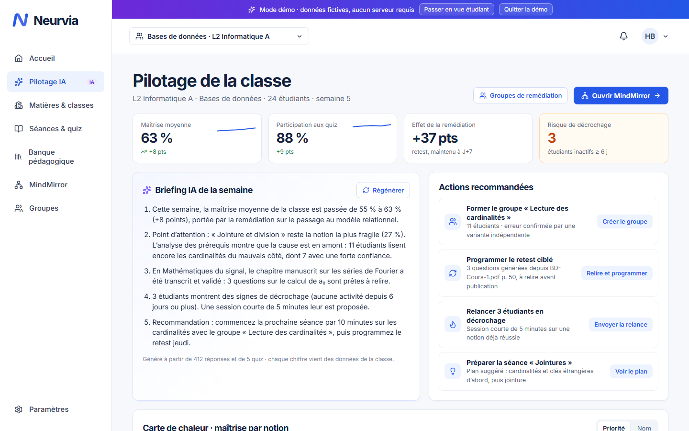

## Sommaire

- [Le défi](#le-défi)
- [Essayer en deux minutes](#essayer-en-deux-minutes)
- [Fonctionnalités](#fonctionnalités)
- [Où intervient l’IA](#où-intervient-lia)
- [Architecture](#architecture)
- [Installation complète](#installation-complète)
- [Tests et qualité](#tests-et-qualité)
- [Structure du dépôt](#structure-du-dépôt)
- [État du projet et limites](#état-du-projet-et-limites)

## Le défi

> Comment concevoir une solution fondée sur l’intelligence artificielle capable de répondre aux difficultés de compréhension des étudiants, d’enrichir leurs processus d’apprentissage et d’améliorer durablement leur expérience éducative ?

| Le défi demande de… | Neurvia répond par… |
| --- | --- |
| **Répondre aux difficultés de compréhension** | Un diagnostic des **erreurs de raisonnement**, pas seulement des notes. Chaque mauvais choix de réponse est relié à une idée fausse connue (« la cardinalité se lit du mauvais côté »). Une erreur donnée avec assurance est traitée comme une idée à corriger, pas comme une étourderie, puis **confirmée** par une question indépendante. La **règle des prérequis** remonte de la notion qui bloque à la lacune qui la cause. |
| **Enrichir les processus d’apprentissage** | Un **coach IA** qui répond à partir des supports du cours et cite ses pages, **Explique-le** (l’étudiant reformule une notion et voit les idées clés couvertes), des quiz générés depuis les PDF du professeur, y compris **manuscrits**, et un **parcours** qui explique pourquoi telle étape est proposée. |
| **Améliorer durablement l’expérience** | Des **révisions espacées**, un **retest** puis un **suivi à J+7** qui vérifient que l’apprentissage tient, une vue **avant / après** pour le professeur et des **signaux de décrochage** pour relancer à temps. |

## Essayer en deux minutes

Le **mode démo** fait tourner toute l’interface dans le navigateur, sur des données fictives, **sans serveur, sans base de données et sans clé d’API**.

```powershell
npm ci
npm run dev -- --port 3151
```

Ouvrez <http://localhost:3151/login>, choisissez **Professeur** ou **Étudiant**, puis cliquez sur **« Lancer la démo »**. Le bandeau violet permet de changer de rôle à tout moment.

La démo met en scène une classe de **L2 Informatique** et deux matières construites à partir de vrais supports de cours : **Bases de données** (`BD-Cours-1.pdf`, modèle Entité-Association) et **Mathématiques du signal** (`Chapitre-1.pdf`, séries de Fourier, **cours manuscrit scanné**).

**Parcours conseillé**

1. **Professeur · Pilotage IA** : briefing de la semaine, actions en un clic, carte de chaleur de la classe.
2. **MindMirror**, puis **Groupes** : constellation des erreurs, groupes de remédiation, plan de 10 minutes, retest.
3. **Séances & quiz → Chapitre 1 BD** : poser une question à l’assistant de cours, qui répond en citant les pages.
4. **Chapitre 2 BD → Préparer le quiz** : questions générées depuis le PDF, chacune avec sa page source.
5. **Mathématiques du signal → Chapitre 1 → Voir les pages** : la page manuscrite à côté de sa transcription, avec les passages incertains à relire.
6. **Étudiant · Mon parcours** (bouton « Pourquoi ? »), **Coach IA**, **Explique-le**, puis le **quiz** de Fourier et la **vérification** dans *Mes tâches*.

## Fonctionnalités

### Pour le professeur

| | |
| --- | --- |
| **Pilotage IA** | Briefing hebdomadaire rédigé par l’IA, actions recommandées exécutables en un clic, carte de chaleur maîtrise × notion, erreurs de la classe, impact de la remédiation et signaux de décrochage. |
| **Documents de cours** | Import de PDF numériques ou **manuscrits** : extraction, OCR, transcription par vision, **relecture obligatoire** des passages incertains, puis indexation. |
| **Assistant de cours** | Questions sur les PDF sélectionnés. Recherche hybride, réponses **citées mot pour mot** avec lien vers la page, refus quand le cours ne contient pas la réponse. |
| **Quiz fondés sur les sources** | Génération depuis les documents : chaque mauvais choix correspond à une erreur diagnostique, chaque question affiche sa page source. **Rien n’est publié sans approbation.** |
| **MindMirror** | Constellation de la classe : les étudiants qui partagent la même erreur se rapprochent. Priorités, profils détaillés et analyse IA des réponses d’un étudiant. |
| **Groupes et remédiation** | Groupes proposés par similarité d’erreurs, plan de remédiation de 10 minutes éditable, affectation, retest ciblé, suivi J+7 et tableau **avant / après**. |
| **Banque pédagogique** | Questions de confirmation, de retest et de révision, relues et approuvées par le professeur. |
| **Matières & classes** | Le professeur déclare ses matières et coche ses classes. Les étudiants choisissent leur classe et suivent automatiquement toutes ses matières. |

| Relecture d’un cours manuscrit | Quiz généré depuis le PDF |
| --- | --- |
| 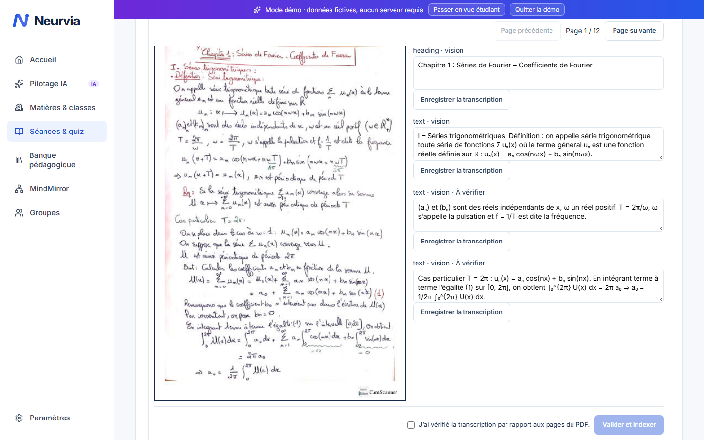 | 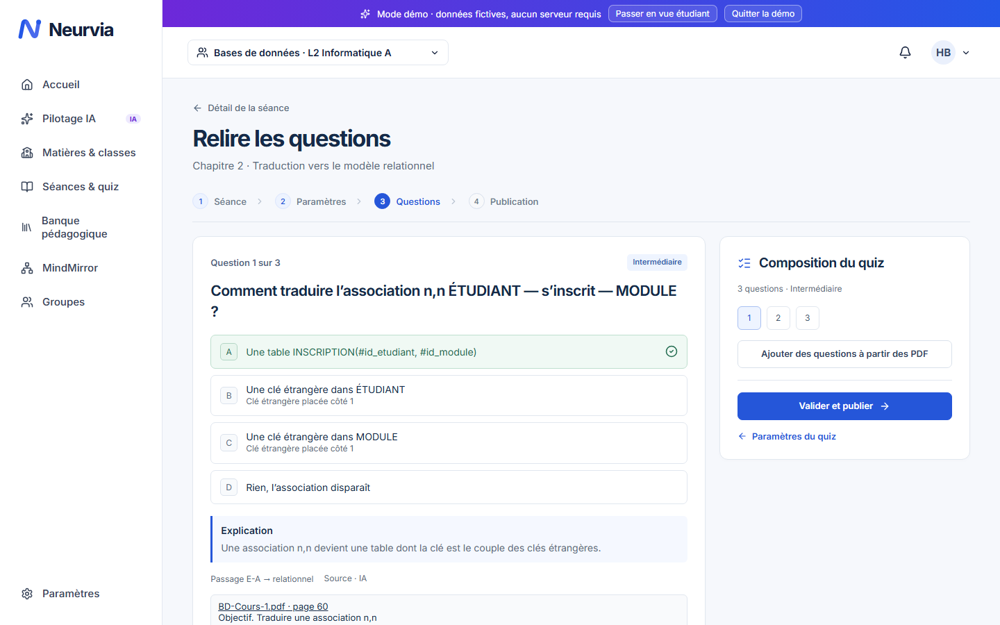 |

| MindMirror | Groupes et remédiation |
| --- | --- |
| 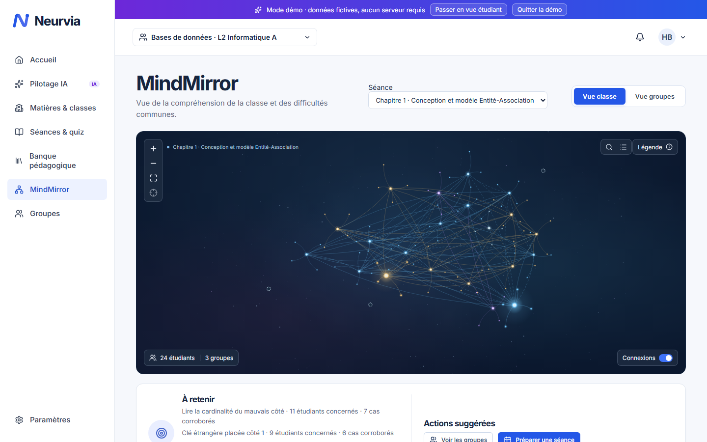 | 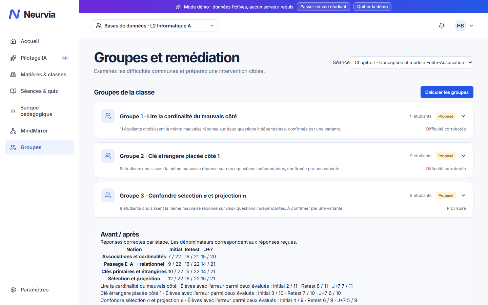 |

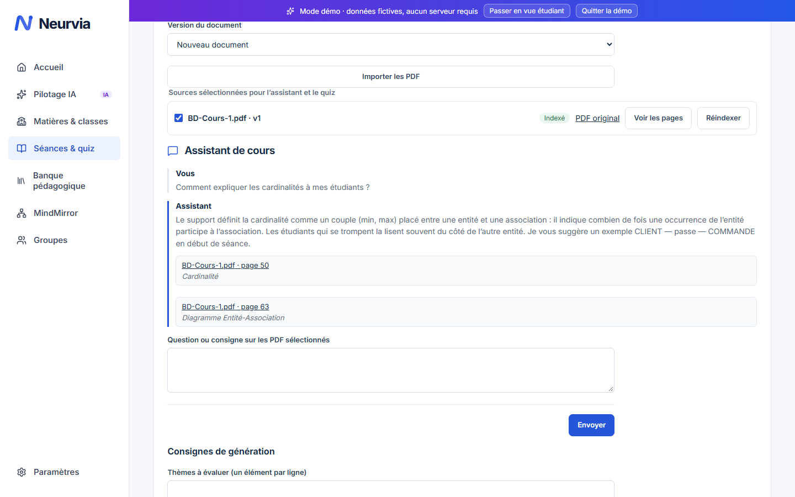

### Pour l’étudiant

| | |
| --- | --- |
| **Mon parcours** | Carte des notions avec la maîtrise estimée et sa fourchette, chemin vers la **lacune de prérequis**, prochaine étape recommandée et panneau **« Pourquoi ? »** (lacune, plateau, incertitude, objectif d’examen, fatigue). |
| **Coach IA** | Conversation fondée sur les supports du cours, avec citations. Il connaît les erreurs fréquentes de l’étudiant et propose des exercices adaptés. |
| **Explique-le** | L’étudiant explique une notion avec ses mots. Neurvia indique les idées clés couvertes et celles à ajouter, avec la page du cours à relire. |
| **Quiz guidé** | Réponse, puis niveau de confiance (non noté), puis correction détaillée. Raccourcis clavier A–D et Entrée. |
| **Vérification** | Une erreur seule reste une hypothèse : une question indépendante la confirme ou l’écarte. |
| **Révisions espacées** | Chaque notion revient au bon moment selon sa maîtrise ; retest immédiat puis révision à J+7. |

| Mon parcours | Coach IA | Explique-le |
| --- | --- | --- |
| 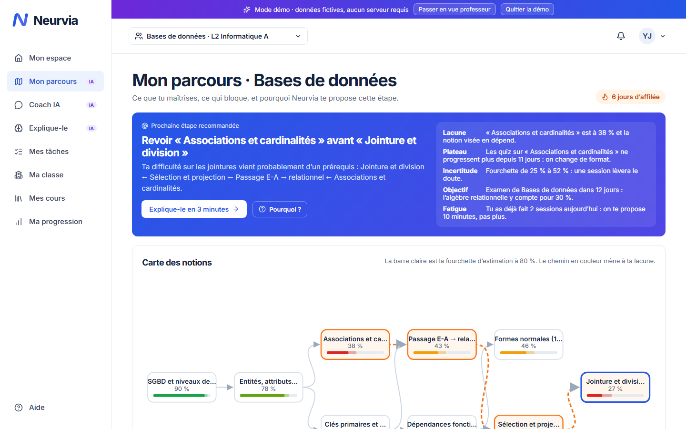 | 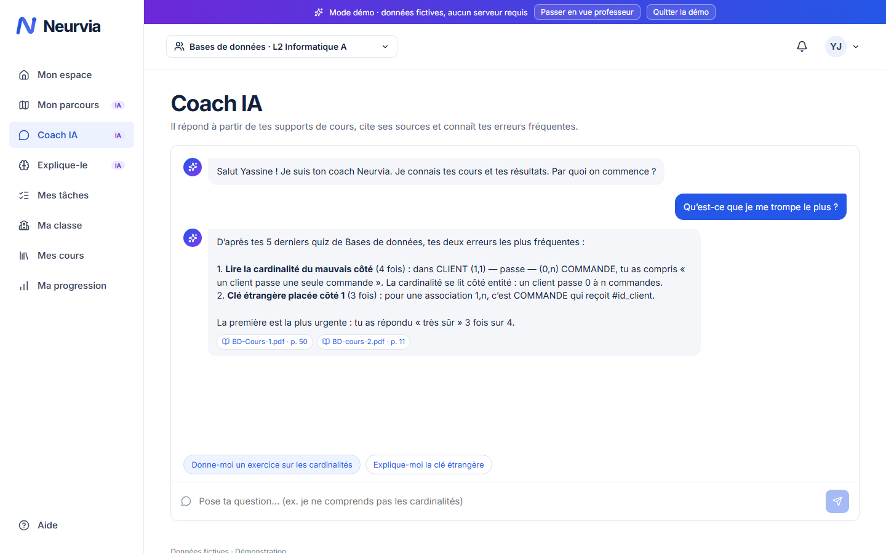 | 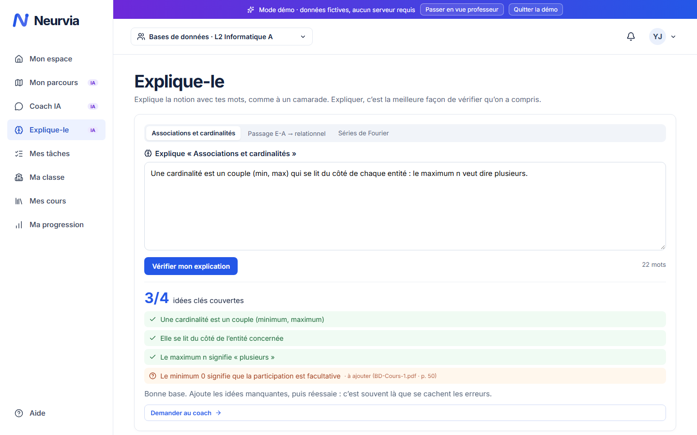 |

## Où intervient l’IA

Neurvia utilise **Gemini** par défaut (`gemini-3.5-flash-lite` pour la génération et la vision, `gemini-embedding-2` pour les embeddings). Ollama et les serveurs compatibles OpenAI restent disponibles sur configuration.

| Étape | Rôle de l’IA | Garde-fou |
| --- | --- | --- |
| Lecture des cours | Transcription des pages scannées ou manuscrites | Passages incertains signalés, relus et validés par le professeur avant indexation |
| Recherche | Embeddings et recherche hybride (pgvector et plein texte) | Filtrage strict par établissement, classe et séance |
| Assistant de cours | Réponse structurée à partir des passages retrouvés | Chaque citation doit exister mot pour mot ; une seconde passe vérifie que la réponse est soutenue |
| Génération de quiz | Questions, distracteurs liés à des erreurs approuvées, variantes de suivi | Une seule bonne réponse vérifiée ; approbation du professeur obligatoire |
| Diagnostic | Hypothèses d’erreur sur les réponses d’un étudiant | Consultatif ; confirmation par une question indépendante |
| Remédiation | Plan de séance de 10 minutes par groupe | Plan éditable, affecté seulement par le professeur |

Les PDF sont traités comme des **données non fiables** : une instruction cachée dans un document ne modifie ni les consignes du modèle ni les droits. Aucune donnée d’identité de l’étudiant n’est envoyée au modèle.

## Architecture

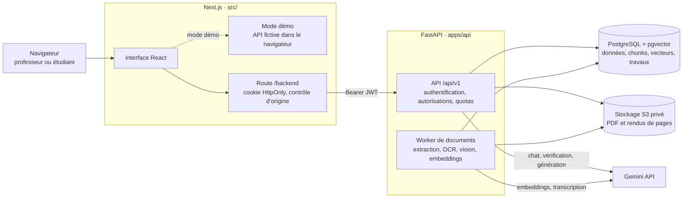

### Boucle diagnostique

```mermaid
flowchart LR
    quiz["Quiz approuvé<br/>et publié"] --> answers["Réponses<br/>+ confiance"]
    answers --> hypothesis["Hypothèse d’erreur"]
    hypothesis --> confirm["Question de<br/>vérification"]
    confirm --> mirror["MindMirror<br/>priorités"]
    mirror --> groups["Groupes<br/>validés par le professeur"]
    groups --> plan["Plan de remédiation<br/>10 minutes"]
    plan --> retest["Retest immédiat"]
    retest --> j7["Révision J+7"]
    j7 --> compare["Avant / après"]
```

### Traitement d’un PDF

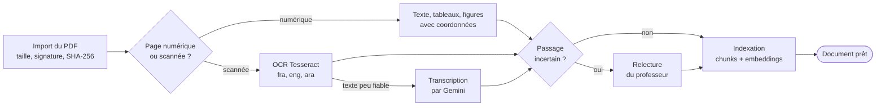

Un passage illisible n’est jamais inventé : il est marqué `[illisible]` et reste à relire.

**Technologies** : Next.js 16 et React 19 · FastAPI, SQLAlchemy, Pydantic · PostgreSQL et pgvector, migrations Alembic · stockage S3 · Gemini. Le contrat d’API est publié dans [docs/openapi.json](docs/openapi.json), avec les types générés dans [docs/api-types.d.ts](docs/api-types.d.ts).

## Installation complète

Le mode démo suffit pour découvrir le produit. L’installation complète active les vrais comptes, l’import de PDF et l’IA.

**Prérequis** : Windows et PowerShell, Python 3.11+, Node.js 24, Docker Desktop et une clé d’API Gemini.

```powershell
python -m venv apps/api/.venv
.\apps\api\.venv\Scripts\python.exe -m pip install -r apps/api/requirements-dev.txt
npm ci
if (!(Test-Path .env)) { Copy-Item .env.example .env }
```

Ajoutez votre clé Gemini dans `.env` (`MODEL_API_KEY=…`) : Docker Compose la transmet à l’API et au worker. Puis lancez la pile :

```powershell
docker compose -f compose.documents.yml up -d --build   # PostgreSQL, S3, API et worker
$env:BACKEND_URL = "http://127.0.0.1:8010/api/v1"
npm run dev -- --port 3151
```

L’interface est sur <http://localhost:3151/login>, la documentation de l’API sur <http://127.0.0.1:8010/docs>.

**Comptes de démonstration réels.** Le script suivant crée, via l’API, une professeure (Hela Ben Amor) qui enseigne les deux matières à **L2 Informatique A** et **B**, et un étudiant (Yassine Jaziri) en L2 Informatique A. L’option `--upload` importe aussi les deux cours :

```powershell
Set-Location apps/api
.\.venv\Scripts\python.exe tools/setup_demo_accounts.py --upload
```

Les identifiants sont définis en tête de [apps/api/tools/setup_demo_accounts.py](apps/api/tools/setup_demo_accounts.py). Pour vérifier la clé et les modèles accessibles : `python -m tools.probe_gemini` depuis `apps/api`.

Le déploiement, les secrets, les sauvegardes et l’exploitation du pipeline documentaire sont décrits dans [docs/DOCUMENTS.md](docs/DOCUMENTS.md). Les mots de passe de `compose.documents.yml` ne servent qu’en local : l’API refuse de démarrer en production avec ces valeurs.

## Tests et qualité

```powershell
npm run lint; npm run typecheck; npm run build
Set-Location apps/api
.\.venv\Scripts\python.exe -m pytest -q        # tests de l’API (SQLite ; PostgreSQL avec NEURVIA_TEST_POSTGRES)
```

- La CI GitHub Actions exécute ces vérifications à chaque push.
- `scripts/verify-workflows.mjs` et `scripts/verify-navigation.mjs` parcourent l’interface avec Playwright.
- Après une modification de l’API : `python -m tools.export_contract` depuis `apps/api`, puis `npx --yes openapi-typescript@7.10.1 docs/openapi.json --output docs/api-types.d.ts`.

## Structure du dépôt

```text
src/
  demo/            mode démo : données fictives et API simulée dans le navigateur
  insights/        Pilotage IA, Mon parcours, Coach IA, Explique-le
  learning/        séances, quiz, documents de cours, espace étudiant
  mirror/          MindMirror et groupes de remédiation
  workspace/       accueil, matières et classes, paramètres
public/backend/demo/  supports de cours de la démo (PDF et rendus de pages)
apps/api/
  app/             API FastAPI : routers, services, modèles, schémas
  app/documents/   extraction, worker, recherche, citations, génération fondée
  app/ai/          passerelle vers les modèles, cache
  alembic/         migrations PostgreSQL
  tools/           comptes de démonstration, vérifications, réindexation
  tests/           tests SQLite et PostgreSQL
data/              banque de questions de référence et jeu de données de démonstration de l’API
docs/              contrat d’API, guide des documents, captures d’écran
compose.documents.yml  pile Docker locale
```

## État du projet et limites

- **Branché sur l’API réelle** : comptes et classes, matières, séances, import et relecture de PDF, assistant de cours, quiz fondés sur les sources, quiz étudiant avec confiance, vérification, MindMirror, groupes, remédiation, retest et suivi J+7.
- **Prototypes sur données de démonstration** : *Pilotage IA*, *Mon parcours*, *Coach IA* et *Explique-le* fonctionnent aujourd’hui sur les données du mode démo. Leur branchement sur l’API est la prochaine étape. Les réponses du coach y sont scénarisées ; l’évaluation d’*Explique-le* repose sur la détection d’idées clés.
- **Quota Gemini** : l’offre gratuite limite les embeddings à 1 000 requêtes par jour, soit l’indexation de quelques cours. Une clé avec facturation est nécessaire pour une classe réelle.
- **Manuscrit** : la transcription doit toujours être relue par le professeur ; c’est un choix de conception, pas seulement une limite.
- Le **mode démo** conserve son état dans l’onglet du navigateur ; il repart de zéro à chaque lancement depuis la page de connexion.
